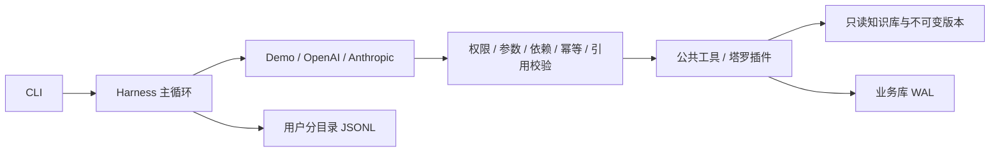

# 知命 · 占卜 Agent Harness

当前完成第一周：隔离的 Python 3.11 环境、手写单 Agent 循环、模型适配、工具注册与 guard、SQLite 业务库、JSONL trace、塔罗插件及结构化知识库。

本地验收：**85 项自动化测试通过，12/12 个离线适用轨迹用例通过，gpt-6.1-sol真实测试17/17通过，完整工程门禁通过。** 已按第一周评审修复追问持久化、重抽种子、回答质量和安全路由；塔罗释义覆盖率100%，Ruff检查通过。详细证据见 [评审修复报告](docs/week1-评审修复报告.md)。人工审核率仍为0%。历史“9/9”只反映旧脚本的宽松计分，已撤回作为验收结论，原始结果保留供对照。

[项目计划](docs/占卜Agent项目计划书.md) · [评估数据集说明](evals/README.md) · [脱敏验收材料](docs/verification/README.md)

当前配置为 OpenAI 兼容接口、模型 `gpt-6.1-sol`，连接凭据保存在本地 `.env`。使用 `--provider demo` 可以切换到离线规则演示。离线测试数字不能代表真实模型的工具选择或解读质量。

## 快速开始（Windows PowerShell）

在项目目录运行一次：

```powershell
powershell -ExecutionPolicy Bypass -File .\setup.ps1
```

脚本将 uv 放在 `.bootstrap`、Python 3.11 放在 `.python-runtimes`、项目环境放在 `.venv`，不改变系统 Python。依赖版本通过 `uv.lock` 锁定。第一周塔罗无需下载星历、GeoNames、Unihan 或 embedding，暂不安装 PyTorch。

```powershell
$env:PYTHONUTF8 = '1'
& .\.venv\Scripts\python.exe cli.py draw --question '下个月适合跳槽吗？' --spread three_card --seed 42
& .\.venv\Scripts\python.exe cli.py draw --question 'A 公司还是 B 公司？' --spread decision --seed 42 --json-output
& .\.venv\Scripts\python.exe cli.py chat
```

固定 seed 只注入会话的首次抽牌，用于测试复现；不传 seed 时每个新 reading 使用系统随机种子。后续重抽始终生成新 seed，并记录 parent_reading_id；纯函数 draw_tarot 的相同 seed 仍能完全复现。同一次 reading 重复同参数抽牌返回缓存，改变参数再抽会被拒绝。

对话命令：`/profile` 查看画像，`/new` 开始新问题，`/redraw` 明确重抽，`/forget` 删除当前用户数据，`/quit` 退出。询问“第二张牌具体什么意思？”会恢复原记录和原知识库版本，不重抽；结构化追问单独保存到 reading_responses，原解读保留。

Linux / 已安装 uv 的环境：`uv sync --locked --extra llm`，然后 `uv run python -m knowledge.build`、`uv run python cli.py chat`。

## 接入真实模型

复制 `.env.example` 为 `.env`，填入所选服务的密钥；兼容服务可以设置 `OPENAI_BASE_URL`。模型名由用户明确配置，项目不猜测默认型号。

```powershell
& .\.venv\Scripts\python.exe cli.py chat --provider openai --model <你的模型名>
& .\.venv\Scripts\python.exe cli.py chat --provider anthropic --model <你的模型名>
```

适配器统一 tool calling、消息历史与 token 统计，针对瞬态连接、限流和服务器错误最多尝试三次；当前单次超时90秒，可在config.yaml调整。SDK HTTP 协议有本地 MockTransport 测试；显式运行 `python -m scripts.live_test --model gpt-6.1-sol` 执行17个严格场景，每次结果保存在 reports/review-fix/独立run_id，保留失败记录。任何工具错误使场景失败，并核对实际入库、种子与引用；同样记录接口返回的cached_tokens，缺失记为未知。自动化 pytest 强制离线，不会调用付费模型。

## 运行路径与约束



`harness/` 不引用领域插件、知识库或数据库。应用在 `app.py` 显式注册工具。塔罗计算使用版本化 SHA256 排序，不使用 Python 内建 `hash()`，可跨进程复现；抽出的牌不重复。种子由 harness 提供，模型不能换 seed 重抽。

工具错误作为结构化结果返给模型；模型故障、步数和 token 上限返回明确失败状态。计算后不能用普通文本绕过 `submit_reading`。同一批工具中终止工具后的调用不执行，但仍补齐工具响应，保持两家模型的协议完整。

第一周工具：`start_reading`、`get_profile`、`update_profile`、`read_reading`、`lookup_meaning`、`draw_tarot`、`ask_user`、`submit_reading`。用户身份由会话注入，模型不能通过参数指定其他用户。画像写入检查原话证据与字段值；复杂归一化留待后续插件接入。

## 知识库与数据

- `knowledge/sources/tarot/cards.yaml`：78 张牌 × 正逆位 = 156 条，加 7 条牌位说明，共 163 条自写草稿。
- `knowledge/rules/tarot.yaml`：信号时间属性与牌位强度规则。倾向值来自条目的 `theme_map`，信号由代码产生。
- `python -m knowledge.build`：检查 schema、id、key、同义词唯一性、许可、数值范围与完整覆盖；构建只读 SQLite 和覆盖率报告。
- `data/kb_versions/<版本>.sqlite`：保留不可变条目与规则快照。版本摘要同时包含源文件与规则内容；旧 reading 的查询使用旧快照。
- **人工审核率当前为 0%。** `reviewed` 没有冒充人工审核，解读强制使用低置信度。达到计划中的发布标准（≥95%）需要逐条人工审核。
- `data/app.db`：画像与历史版本、readings、reading_responses、daily，以及后续专家、审校和排盘缓存的表结构。当前启用画像、塔罗reading与追问回答；已有库自动增建追问表，schema版本为2。
- `runs/<用户摘要>/<会话>.jsonl`：工具参数、结果、错误、时间和 token 使用量；模型异常只记录异常类别，避免 SDK 错误文本泄露凭据。
- `evals/cases/` 和 `evals/generators/` 从用户提供的评估数据集复制，保留原稿状态，不改参考答案。

SQLite FTS5 已构建并检查可用；第一周精确查找不依赖分词或向量检索。解梦中文分词与 sqlite-vec 留到对应开发周。`scripts/fetch_data.py` 支持 HTTPS、SHA256 校验、缓存与目录边界检查；清单当前为空，后续数据须填入真实 URL 和经核实的哈希。

## 测试和验收

```powershell
& .\.venv\Scripts\python.exe -m scripts.doctor
& .\.venv\Scripts\python.exe -m scripts.doctor --api
& .\.venv\Scripts\python.exe -m pytest -q --junitxml=reports/week1-tests.xml
& .\.venv\Scripts\python.exe -m evals.run --suite week1
& .\.venv\Scripts\ruff.exe check harness agents common plugins knowledge memory scripts tests evals app.py cli.py
& .\.venv\Scripts\ruff.exe format --check harness agents common plugins knowledge memory scripts tests evals app.py cli.py
```

测试覆盖确定性抽牌、完整释义、知识库历史版本、权限与分区、依赖、画像证据、重复调用、输出引用和事实检查、预算、异常、追问、用户隔离、删除数据，以及两家 SDK 的 HTTP 协议。

`evals.run --suite week1` 只跑原 80 题中适用于已接入塔罗的 12 题，其余 68 题跳过；自动保留每题 trace。工具集合 F1 是离线演示模式的流程指标，原数据集仍需人工审核。报告输出到 `reports/week1-eval.md` 与 JSON。跨平台 GitHub Actions 配置已添加，运行结果以仓库 Actions 为准。本地生成的 reports/、runs/ 和 data/ 不纳入版本控制；随源码归档的脱敏汇总位于 docs/verification/。

## 隐私、当前限制和后续工作

用户数据落盘在本地；真实模型 API 会收到执行任务需要的对话、画像与工具结果。`/forget` 删除当前用户在应用数据库、trace 和内存中的数据，并压缩 SQLite；不能删除第三方模型服务留存、系统备份或已导出的报告。

第一周的规则只能检查结构化引用、显式牌名与部分位置及方向事实，不能证明每一句自然语言都受引用支持。健康、法律、投资、生死问题有基础标注规则；识别到明确自伤表达会停止占卜。更完整的语义安全、事实支持与审校评估留到第五至七周。

当前支持原数据集中的五个危机场景及中途危机转折。隐晦的消失/永远睡去等表达先由同一模型分类，分类失败则暂停占卜并确认安全。回复询问是否安全，鼓励可信的人陪伴并提供当地紧急渠道。config.yaml的safety.region默认空，不假定中文用户地区；可按部署或会话设置CN/US及经核实的emergency_contacts。新增地区需配置真实可用渠道，不生成未经核实的热线。

抽牌直接返回版本固定的精确释义，新解读通常3轮模型调用，原牌追问2轮。完整信号仍保存到SQLite与trace，给模型传递精简工具结果；已完成轮次的工具JSON从后续对话上下文移除，跨会话从数据库恢复。稳定系统提示与工具结构保持前缀稳定，缓存是否命中以接口usage为准。

第二周接入本命盘和行运；第三周接入八字；第四周接入专家并行；第五周交叉合并与审校；第六周姓名、解梦与每日运势；第七周完整评估。当前不把后续能力声明为已实现。
