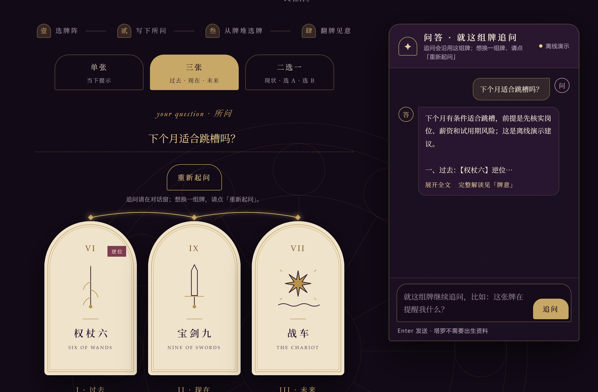
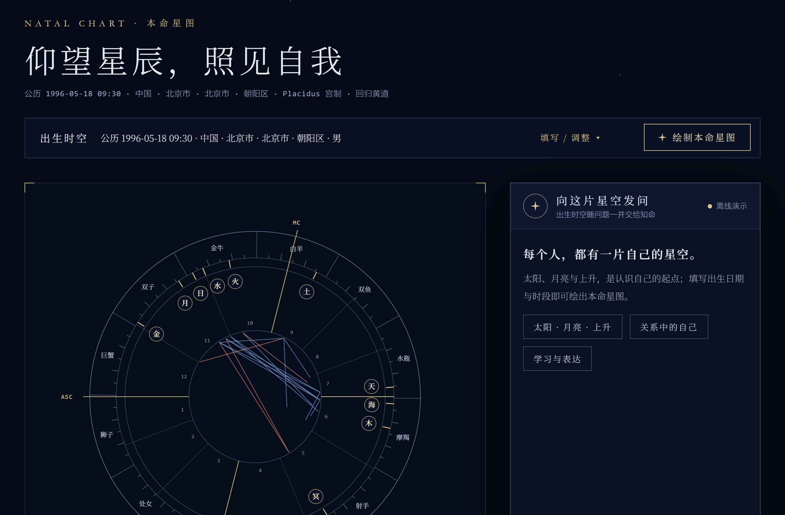
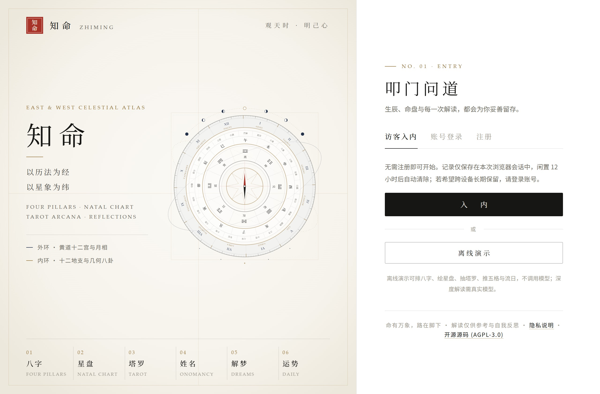
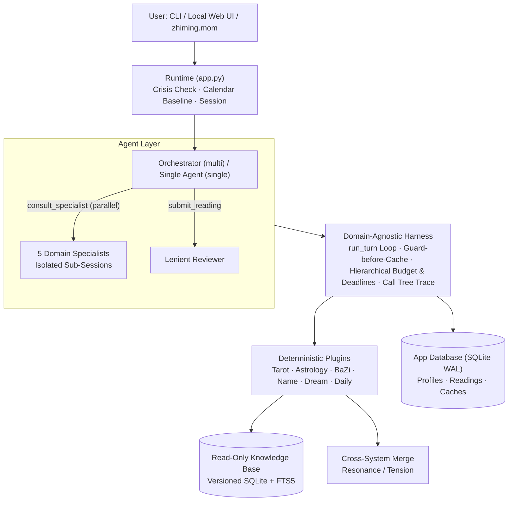

<p align="right">
  <strong>English</strong> | <a href="README.zh-CN.md">简体中文</a>
</p>

# ZhiMing (知命) — Framework-Free Multi-Agent Harness with Verifiable Facts & MCP Server

[](https://github.com/stanGSA/ZhiMing/actions/workflows/ci.yml)

[](LICENSE)
[](https://github.com/stanGSA/ZhiMing/releases)
[](#use-as-an-mcp-server-claude-desktop)
[](https://zhiming.mom)

> **Live Demo (zero install — real-time BaZi & Natal Chart calculation + offline Tarot demo):** [https://zhiming.mom](https://zhiming.mom)
> Want a self-contained, zero-API-key cloud sandbox? See the Hugging Face Spaces offline Docker setup in [`deploy/hf-space/`](deploy/hf-space/README.md).

**ZhiMing** is a **framework-free LLM agent harness** written from scratch in Python (no LangChain, no LangGraph), built around six deterministic domain plugins: **Tarot, Western Astrology, BaZi (Chinese Four Pillars), Chinese Onomancy (Wuge), Dream Interpretation, and Daily Fortune**.

**Every symbolic fact—ephemeris longitudes, house cusps, solar terms, stems/branches, and drawn cards—is computed by deterministic code. The LLM only synthesizes the reading, and every fact and `ref_id` cited in its answer is verified item-by-item by code; hallucinations are rejected and rewritten.**

### Why divination as an agent engineering benchmark?

Divination puts two hard LLM challenges side-by-side:
1. **Strict factual grounding** — planetary positions, exact transit dates, solar-term transitions, Kangxi stroke counts, and upright/reversed cards are mathematically verifiable, yet LLMs constantly fabricate them.
2. **Nuanced narrative synthesis** — turning multi-system signals (including conflicting ones) into layered, honest guidance still requires a language model.

All offline benchmarks are reproducible in ~10 seconds with one command (`uv run python -m evals.report`, zero API calls); full report in [`reports/eval/summary.md`](reports/eval/summary.md).

| Tarot: Interactive Deck, Flip & Verifiable Reading | BaZi: Four Pillars, Ten Gods, Hidden Stems & WuXing |
| --- | --- |
|  |  |
| **Western Astrology: Natal Wheel, Houses & Aspects** | **Entry Portal (East & West Celestial Atlas)** |
|  |  |

<sub>Captured in local offline demo mode using synthetic birth data. Charts and pillars are computed deterministically; offline tarot prose comes from a rule-based demo model rather than a live LLM.</sub>

---

## Architecture



Both execution modes share the exact same harness and plugins:

- **`single` (default):** One agent calls all tools directly — serves as the control baseline.
- **`multi`:** An orchestrator with *zero* direct calculation tools understands the question, asks follow-ups, dispatches up to 5 isolated domain specialists in parallel (`consult_specialist`), merges cross-system resonance/tension in code, and passes the draft reading through a lenient reviewer before delivery.

---

## Engineering Highlights

- **Hand-written async agent loop** ([`harness/loop.py`](harness/loop.py)): Executes parallelizable tool calls within a turn concurrently via `asyncio.TaskGroup`, then commits results to session state in original call order. Calls after a terminal tool are skipped while still emitting protocol-complete tool responses; cancelled turns also backfill pending tool responses so OpenAI/Anthropic/DeepSeek message histories stay valid.
- **Guard before cache** ([`harness/guard.py`](harness/guard.py)): Every tool call runs through JSON parsing, tool registry, role permissions, system partition checks, schema validation, required profile fields, prerequisites, and custom validators *before* consulting the idempotent cache — cache hits never bypass authorization. Errors return as structured payloads for model self-correction (with targeted partial self-repair and 3-strike identical-failure circuit breaking).
- **Hierarchical token budget & admission control** ([`harness/budget.py`](harness/budget.py)): One request-level budget with per-specialist sub-budgets. Before each model call in `multi` mode, estimated tokens are reserved up front so concurrent specialists cannot overspend the parent budget or eat into the orchestrator's reserve, then settled against actual usage. Wall-clock deadlines stop tool execution once expired.
- **Strict fact binding vs. lenient expression repair** (`plugins/*/validation.py`, [`common/validation.py`](common/validation.py), [`common/output_policy.py`](common/output_policy.py)): Every card name, orientation, pillar, planet sign/house, aspect date, and `ref_id` must trace to the current turn's tool outputs — mismatches are rejected by code. Formatting issues (disclaimers, `<br>` tags) are auto-normalized instead of forcing rewrite loops.
- **Specialist isolation & atomic state** ([`agents/consult.py`](agents/consult.py)): Specialists only see tools, KB partitions, and profile fields for their own system. Successful reports atomically replace signals/citations; failed retries preserve the last valid report; tarot draws are immutable per reading. Child sub-session traces attach to their parent tool call via `ContextVar` to reconstruct full call trees.
- **Code-computed cross-system tension** ([`signals/merge.py`](signals/merge.py)): Signals across systems are aligned by time horizon to compute resonance and tension deterministically. In `multi` mode, the final answer *must* disclose every tension — user-preferred system weights shift synthesis emphasis without hiding disagreements.
- **Safety boundaries** ([`common/safety.py`](common/safety.py)): Crisis expressions immediately halt divination and surface region-matched emergency hotlines until the user explicitly confirms safety. Deterministic predictions on health, legal, financial investment, or mortality are disallowed.

See [`docs/design.md`](docs/design.md) for full invariants, calculation conventions, and architectural notes.

---

## Use as an MCP Server (Claude Desktop)

[`mcp_server/`](mcp_server/) exposes **10 deterministic calculation and lookup tools** over standard [Model Context Protocol (MCP)](https://modelcontextprotocol.io) `stdio` transport — **zero LLM calls inside the server**, identical inputs yield identical outputs (with explicit `seed` for Tarot), and every meaning carries a `ref_id` and audit level (`review.confidence_cap`).

### 1. Install dependencies & build local data

```bash
uv sync --locked --extra mcp
uv run python -m scripts.fetch_data   # SHA256-verified Swiss Ephemeris, JPL DE440s, GeoNames, Unihan (~70 MB)
uv run python -m knowledge.build      # Build versioned read-only SQLite knowledge base
```

### 2. Add to `claude_desktop_config.json`

**macOS / Linux** (`~/Library/Application Support/Claude/claude_desktop_config.json`):

```json
{
  "mcpServers": {
    "zhiming": {
      "command": "/Users/<your-user>/.local/bin/uv",
      "args": [
        "--directory",
        "/Users/<your-user>/ZhiMing",
        "run",
        "--extra",
        "mcp",
        "python",
        "-m",
        "mcp_server"
      ]
    }
  }
}
```

**Windows** (`%APPDATA%\Claude\claude_desktop_config.json`, using `setup.ps1`'s `.bootstrap\Scripts\uv.exe` or `where.exe uv`):

```json
{
  "mcpServers": {
    "zhiming": {
      "command": "C:\\Users\\<your-user>\\ZhiMing\\.bootstrap\\Scripts\\uv.exe",
      "args": ["--directory", "C:\\Users\\<your-user>\\ZhiMing", "run", "--extra", "mcp", "python", "-m", "mcp_server"],
      "env": { "PYTHONUTF8": "1" }
    }
  }
}
```

### Available MCP Tools

| Tool | Description |
| --- | --- |
| `resolve_location` | Resolve birthplace to `location_id`, lat/lon & IANA timezone (returns candidates on ambiguity) |
| `compute_natal_chart` | Western natal chart: planetary signs/houses, four angles, exact aspects (Swiss Ephemeris) |
| `compute_transits` | Exact transit-to-natal aspects across a consultation date range and timezone |
| `compute_bazi` | Four Pillars (BaZi), Ten Gods, hidden stems, NaYin, WuXing counts, and 10-year Dayun |
| `compute_bazi_period` | Annual, solar-term monthly, or daily pillars with natal interactions |
| `draw_tarot` | Reproducible SHA256-shuffled draws (`single`, `three_card`, `decision`) with `seed` / `picks` |
| `analyze_name` | Unicode Unihan 18.0 Kangxi stroke counts, Wuge numerology, and Sancai five elements |
| `lookup_dream_symbols` | Match dream symbols against the curated KB (unmatched symbols are explicitly reported) |
| `daily_fortune` | Daily transits, day pillar & Ten Gods, and deterministic daily card |
| `lookup_meaning` | Exact KB entry lookup by `(system, kind, key)` with audit metadata |

> **AGPL-3.0 & Swiss Ephemeris notice:** Local `stdio` personal use in Claude Desktop is fine; exposing this MCP server or web app as a network service triggers AGPL-3.0 Section 13 (provide corresponding source code) unless you hold a commercial Swiss Ephemeris license from Astrodienst. See [`LICENSE`](LICENSE), [`NOTICE`](NOTICE), and [`docs/usage.md`](docs/usage.md#mcp-server确定性插件).

---

## Benchmarks & Radical Honesty

Regenerate [`reports/eval/summary.md`](reports/eval/summary.md) completely offline (~10 seconds, zero API keys):

```bash
uv run python -m evals.report    # or: make eval
```

### Deterministic & Offline Verification

| Benchmark | Result | Notes |
| --- | --- | --- |
| Reference Natal Charts | **11/11 passed**, max ecliptic error `0.000110364°` | Cross-verified against Skyfield + NASA JPL DE440s (max diff `0.000000611°`) |
| BaZi Edge Cases | **50/50 cases**, 57 rule/follow-up variants passed | Lichun year rollover, solar-term months, Zishi hour, true solar time, DST, lunar leap months |
| Kangxi Name Strokes | **200/200 matched** | Unicode Unihan 18.0 (19 gold entries pending human finalization) |
| Daily Fortune Consistency | **10/10 cross-session identical** | Cached per user & consultation date |
| Crisis Detection | **5/5** (draft dataset) | Halts divination and surfaces region-matched emergency hotlines |
| Offline Test Suite | **1,200+ automated tests** | Ubuntu & Windows CI, zero paid API calls ([`tests/README.md`](tests/README.md)) |

### Live LLM Benchmark (Archived — All Failures Preserved)

20 questions × 3 runs (`deepseek-v4-flash`, judged by `deepseek-v4-pro`, rubric `v2-2026-10-24`; full archive in [`docs/verification/p1/README.md`](docs/verification/p1/README.md)):

| Date | Model | Build | Mode | Task Done | Quality Pass | Strict Overall | P50 / P95 Latency |
| --- | --- | --- | --- | ---: | ---: | ---: | ---: |
| 2026-10-25 | `deepseek-v4-flash` | Final | `single` | 37/60 | 24/60 | 10/60 | 92 / 280 s |
| 2026-10-25 | `deepseek-v4-flash` | Final | `multi` | 33/60 | 28/60 | 8/60 | 107 / 232 s |
| 2026-10-24 | `deepseek-v4-flash` | Baseline (B0) | `single` | 34/60 | 24/60 | 9/60 | 74 / 164 s |
| 2026-10-24 | `deepseek-v4-flash` | Baseline (B0) | `multi` | 37/60 | 25/60 | 14/60 | 139 / 253 s |

*Why we publish these numbers as-is:* "Strict Overall" requires passing every engineering invariant **and** all four quality rubrics simultaneously (and the judge shares a vendor with the evaluated model, with human calibration still pending). Because live end-to-end quality has not yet cleared our self-imposed release bar, `single` remains the default mode and **every failure record is kept without cherry-picking**.

---

## Quick Start

Requires [uv](https://docs.astral.sh/uv/getting-started/installation/), which provisions Python 3.11 and locked dependencies automatically.

### Linux / macOS

```bash
git clone https://github.com/stanGSA/ZhiMing.git && cd ZhiMing
uv sync --locked --extra llm --extra web
uv run python -m scripts.fetch_data   # SHA256-verified ephemeris, GeoNames & Unihan (~70 MB)
uv run python -m knowledge.build      # Build read-only SQLite knowledge base
uv run python web.py                  # Open http://127.0.0.1:8765 and click "离线演示" (Offline Demo)
```

### Windows (PowerShell)

```powershell
powershell -ExecutionPolicy Bypass -File .\setup.ps1   # Installs uv, Python 3.11, deps, data & KB
& .\.venv\Scripts\python.exe web.py
```

### CLI (Zero API Keys in Demo Mode)

```bash
uv run python cli.py draw --question 'Should I switch jobs next month?' --spread three_card --provider demo --seed 42
uv run python cli.py draw --question 'Company A or Company B?' --spread decision --mode multi --provider demo
uv run python cli.py chat --provider demo
```

### Connect a Live LLM

Copy `.env.example` to `.env` and set `DEEPSEEK_API_KEY` (default model `deepseek-flash` in `config.yaml`). OpenAI-compatible APIs use `OPENAI_API_KEY` + `OPENAI_BASE_URL`; Anthropic uses `ANTHROPIC_API_KEY` with `--provider anthropic --model <model>`.

```bash
uv run python cli.py chat                 # Single agent
uv run python cli.py chat --mode multi    # Orchestrator + 5 Specialists + Reviewer
```

### Run Tests & Diagnostics

```bash
uv run pytest -q                          # Fully offline (run `uv run playwright install chromium` for browser tests)
uv run python -m scripts.doctor           # Verify Python, SQLite FTS5, ephemeris hashes & KB
```

---

## Project Structure

| Path | Description |
| --- | --- |
| [`harness/`](harness/) | Domain-agnostic agent runtime: loop, tool registry, Guard, budget, session, tracer, OpenAI/Anthropic adapters |
| [`agents/`](agents/) | Orchestrator & specialist prompts, isolated consultation, lenient reviewer, offline demo model |
| [`plugins/`](plugins/) | Six deterministic divination plugins: calculators, tool specs, fact validators, and session-free `direct.py` |
| [`mcp_server/`](mcp_server/) | FastMCP `stdio` server exposing the 10 deterministic tools |
| [`knowledge/`](knowledge/) | Original KB YAML sources, merge rules, review ledger, and SQLite builder |
| [`signals/`](signals/) | Cross-system time-horizon alignment and resonance/tension merge |
| [`common/`](common/) | Location resolver, region hierarchy, safety boundaries, and output policy |
| [`memory/`](memory/) | SQLite WAL store (profiles, readings, caches) and scrypt-backed web accounts (`accounts.py`) |
| `app.py` `cli.py` `web.py` [`web_static/`](web_static/) | Runtime wiring, CLI, and editorial web UI |
| [`evals/`](evals/) | Evaluation datasets and offline benchmark reporter |
| [`deploy/hf-space/`](deploy/hf-space/) | Self-contained offline demo Docker deployment for Hugging Face Spaces |
| [`tests/`](tests/) | Modular offline test suite (1,200+ tests) |
| [`docs/`](docs/) | Design spec ([`design.md`](docs/design.md)), usage guide ([`usage.md`](docs/usage.md)), verification artifacts & [`archive/`](docs/archive/) |

---

## Current Status & Limitations

- **Actively maintained (`v0.2.0`):** Recent updates include the full editorial web UI redesign, email accounts & cloud reading history, targeted harness partial self-repair, and automated external uptime monitoring (see [`CHANGELOG.md`](CHANGELOG.md)).
- **Knowledge base review status:** All 1,171 entries are original: 451 dual-model cross-reviewed, 720 drafts, 0 human-reviewed. Output confidence is capped by the lowest review tier used (`low` for drafts, max `medium` for model-reviewed).
- **Deployment model:** Local runs bind to `127.0.0.1` by default; the hosted live demo runs at [zhiming.mom](https://zhiming.mom), and a stateless offline-only Hugging Face Spaces Docker recipe is provided in [`deploy/hf-space/`](deploy/hf-space/README.md).
- **Disclaimer:** Readings are for reflection and exploration only — never a substitute for medical, legal, or financial decisions.

---

## License & Support

- Released under **[AGPL-3.0-or-later](LICENSE)**; third-party data attributions (Swiss Ephemeris, NASA/JPL DE440s, GeoNames CC BY 4.0, Unicode Unihan 18.0) are documented in **[NOTICE](NOTICE)**.
- Support server & compute costs on Afdian: https://afdian.com/a/zhiming_ai
