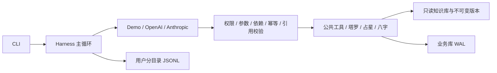

# 知命 · 占卜 Agent Harness

当前已接入前三周的塔罗、西方占星和八字。第四周新增多 Agent 模式（编排者 + 占星、八字、塔罗三位专家并行），离线测试通过，**真实模型验收尚未进行**，因此默认仍为单 Agent（`mode: single`）。第二周与第三周的确定性计算关口已通过；真实回答质量、工程检查和发布前人工审核分别记录。见 [第四周验收](docs/week4-验收报告.md)。

第二周：11/11 参考盘通过，最大黄经误差 **0.000110364°**；Skyfield/JPL 独立交叉验证最大差 **0.000000611°**。第三周：**50/50 边界用例、57 个规则或追问变体通过**。占星280条、八字141条、塔罗163条均为原创草稿，覆盖率100%，人工审核率0%。详见 [第二周验收](docs/week2-验收报告.md)、[第三周验收](docs/week3-验收报告.md) 与 [联合测试证据](docs/verification/week23/README.md)。第一周原报告和原始失败记录保留。

[项目计划](docs/占卜Agent项目计划书.md) · [评估数据集说明](evals/README.md) · [脱敏验收材料](docs/verification/README.md)

当前配置为 OpenAI 兼容接口、模型 `gpt-6.1-sol`，连接凭据保存在本地 `.env`。使用 `--provider demo` 可以切换到离线规则演示。离线测试数字不能代表真实模型的工具选择或解读质量。

## 快速开始（Windows PowerShell）

在项目目录运行一次：

```powershell
powershell -ExecutionPolicy Bypass -File .\setup.ps1
```

脚本将 uv 放在 `.bootstrap`、Python 3.11 放在 `.python-runtimes`、项目环境放在 `.venv`，不改变系统 Python。依赖版本通过 `uv.lock` 锁定。现在会下载并校验 Swiss 星历、JPL DE440s 和 GeoNames；不安装 Unihan、embedding 或 PyTorch。

```powershell
$env:PYTHONUTF8 = '1'
& .\.venv\Scripts\python.exe cli.py draw --question '下个月适合跳槽吗？' --spread three_card --seed 42
& .\.venv\Scripts\python.exe cli.py draw --question 'A 公司还是 B 公司？' --spread decision --seed 42 --json-output
& .\.venv\Scripts\python.exe cli.py chat
```

固定 seed 只注入会话的首次抽牌，用于测试复现；不传 seed 时每个新 reading 使用系统随机种子。后续重抽始终生成新 seed，并记录 parent_reading_id；纯函数 draw_tarot 的相同 seed 仍能完全复现。同一次 reading 重复同参数抽牌返回缓存，改变参数再抽会被拒绝。

对话命令：`/profile` 查看画像，`/new` 开始新问题，`/redraw` 明确重抽，`/forget` 删除当前用户数据，`/quit` 退出。询问“第二张牌具体什么意思？”会恢复原记录和原知识库版本，不重抽；结构化追问单独保存到 reading_responses，原解读保留。

Linux / 已安装 uv 的环境：`uv sync --locked --extra llm`，然后 `uv run python -m knowledge.build`、`uv run python cli.py chat`。

## 接入真实模型

复制 `.env.example` 为 `.env`，填入所选服务的密钥；兼容服务可以设置 `OPENAI_BASE_URL`。模型名由用户明确配置，项目不猜测默认型号。

```powershell
& .\.venv\Scripts\python.exe cli.py chat --provider openai --model <你的模型名>
& .\.venv\Scripts\python.exe cli.py chat --provider anthropic --model <你的模型名>
```

适配器统一 tool calling、消息历史与 token 统计，针对瞬态连接、限流和服务器错误最多尝试三次；当前单次超时90秒，可在config.yaml调整。SDK HTTP 协议有本地 MockTransport 测试；显式运行 `python -m scripts.live_test --model gpt-6.1-sol` 执行17个严格场景，每次结果保存在 reports/review-fix/独立run_id，保留失败记录。任何工具错误使场景失败，并核对实际入库、种子与引用；同样记录接口返回的cached_tokens，缺失记为未知。自动化 pytest 强制离线，不会调用付费模型。

## 运行路径与约束



`harness/` 不引用领域插件、知识库或数据库。应用在 `app.py` 显式注册工具。塔罗计算使用版本化 SHA256 排序，不使用 Python 内建 `hash()`，可跨进程复现；抽出的牌不重复。种子由 harness 提供，模型不能换 seed 重抽。

工具错误作为结构化结果返给模型；模型故障、步数和 token 上限返回明确失败状态。计算后不能用普通文本绕过 `submit_reading`。同一批工具中终止工具后的调用不执行，但仍补齐工具响应，保持两家模型的协议完整。

基础工具：`start_reading`、`get_profile`、`update_profile`、`read_reading`、`lookup_meaning`、`draw_tarot`、`ask_user`、`submit_reading`。用户身份由会话注入，模型不能通过参数指定其他用户。画像写入检查原话证据与字段值，支持中文日期、时刻、性别及排盘口径规范化。

## 知识库与数据

- `knowledge/sources/tarot/cards.yaml`：78 张牌 × 正逆位 = 156 条，加 7 条牌位说明，共 163 条自写草稿。
- `knowledge/sources/astro/entries.yaml`：280条占星草稿；`knowledge/sources/bazi/entries.yaml`：141条八字草稿。两个体系规则独立版本化，组合组件引用随历史记录保存。
- `knowledge/rules/tarot.yaml`：信号时间属性与牌位强度规则。倾向值来自条目的 `theme_map`，信号由代码产生。
- `python -m knowledge.build`：检查 schema、id、key、同义词唯一性、许可、数值范围与完整覆盖；构建只读 SQLite 和覆盖率报告。
- `data/kb_versions/<版本>.sqlite`：保留不可变条目与规则快照。版本摘要同时包含源文件与规则内容；旧 reading 的查询使用旧快照。
- **人工审核率当前为 0%。** `reviewed` 没有冒充人工审核，解读强制使用低置信度。达到计划中的发布标准（≥95%）需要逐条人工审核。
- `data/app.db`：画像与历史版本、readings、reading_responses、daily，以及后续专家、审校和排盘缓存的表结构。当前启用画像、三体系reading与追问回答，以及chart_id/bazi_id缓存；自动迁移至schema版本3，旧行与知识版本保留。
- `runs/<用户摘要>/<会话>.jsonl`：工具参数、结果、错误、时间和 token 使用量；模型异常只记录异常类别，避免 SDK 错误文本泄露凭据。
- `evals/cases/` 和 `evals/generators/` 从用户提供的评估数据集复制，保留原稿状态，不改参考答案。

SQLite FTS5 已构建并检查可用；第一周精确查找不依赖分词或向量检索。解梦中文分词与 sqlite-vec 留到对应开发周。`scripts/fetch_data.py` 支持 HTTPS、SHA256 校验、缓存与目录边界检查；清单已固定四项数据的来源、许可、版本与SHA256。地名数据改用geonamescache 3.0.2发布归档中的GeoNames cities15000固定快照（只读取JSON，不安装或执行归档代码），固定URL与SHA256；旧快照仍保留本地。CI先下载并核验四项数据，再运行doctor和测试。

## 测试和验收

```powershell
& .\.venv\Scripts\python.exe -m scripts.doctor
& .\.venv\Scripts\python.exe -m scripts.doctor --api
& .\.venv\Scripts\python.exe -m pytest -q --junitxml=reports/week1-tests.xml
& .\.venv\Scripts\python.exe -m evals.run --suite week1
& .\.venv\Scripts\ruff.exe check harness agents common plugins knowledge memory scripts tests evals app.py cli.py
& .\.venv\Scripts\ruff.exe format --check harness agents common plugins knowledge memory scripts tests evals app.py cli.py
```

测试覆盖确定性抽牌、完整释义、知识库历史版本、权限与分区、依赖、画像证据、重复调用、输出引用和事实检查、预算、异常、追问、用户隔离、删除数据，以及两家 SDK 的 HTTP 协议。

`evals.run --suite week1` 只跑原 80 题中适用于已接入塔罗的 12 题，其余 68 题跳过；自动保留每题 trace。工具集合 F1 是离线演示模式的流程指标，原数据集仍需人工审核。报告输出到 `reports/week1-eval.md` 与 JSON。跨平台 GitHub Actions 配置已添加，运行结果以仓库 Actions 为准。本地生成的 reports/、runs/ 和 data/ 不纳入版本控制；随源码归档的脱敏汇总位于 docs/verification/。

## 隐私、当前限制和后续工作

用户数据落盘在本地；真实模型 API 会收到执行任务需要的对话、画像与工具结果。`/forget` 删除当前用户在应用数据库、trace 和内存中的数据，并压缩 SQLite；不能删除第三方模型服务留存、系统备份或已导出的报告。

第一周的规则只能检查结构化引用、显式牌名与部分位置及方向事实，不能证明每一句自然语言都受引用支持。健康、法律、投资、生死问题有基础标注规则；识别到明确自伤表达会停止占卜。更完整的语义安全、事实支持与审校评估留到第五至七周。

当前支持原数据集中的五个危机场景及中途危机转折。隐晦的消失/永远睡去等表达先由同一模型分类，分类失败则暂停占卜并确认安全。回复询问是否安全，鼓励可信的人陪伴并提供当地紧急渠道。config.yaml的safety.region默认空，不假定中文用户地区；可按部署或会话设置CN/US及经核实的emergency_contacts。新增地区需配置真实可用渠道，不生成未经核实的热线。

抽牌直接返回版本固定的精确释义，新解读通常3轮模型调用，原牌追问2轮。完整信号仍保存到SQLite与trace，给模型传递精简工具结果；已完成轮次的工具JSON从后续对话上下文移除，跨会话从数据库恢复。稳定系统提示与工具结构保持前缀稳定，缓存是否命中以接口usage为准。

第二周已接入本命盘和行运，第三周已接入八字，第四周已实现多 Agent 编排（真实模型验收待完成）。第五周交叉合并与审校；第六周姓名、解梦与每日运势（届时加入对应专家）；第七周完整评估。当前不把后续能力声明为已实现。

## 第四周：多 Agent 模式

`config.yaml` 的 `mode` 可选 `single` 或 `multi`，命令行用 `--mode` 覆盖：

```powershell
& .\.venv\Scripts\python.exe cli.py chat --mode multi
& .\.venv\Scripts\python.exe cli.py draw --question 'A 公司还是 B 公司？' --spread decision --mode multi --provider demo
```

- **分工**：编排者负责读画像、解析地点、选择专家、合并追问和写最终回答，自己不能调用任何排盘或抽牌工具。占星、八字、塔罗专家各在隔离子会话中只用本插件工具和本分区释义，用 `submit_report` 返回结构化报告（answer、带 ref_id 的 points、missing、confidence）。信号由 harness 从计算结果附加，专家改不了。
- **并行**：编排者在同一步发出的多个 `consult_specialist` 并发执行（上限 `max_parallel_specialists`），结果按调用顺序并入当前记录。readings 和 specialist_reports 只由编排者写入。
- **约束**：
  - 编排者写的子问题不算用户原话，出生资料仍按用户原话核验；
  - 专家需要补充资料时由编排者统一追问，追问结果不缓存；
  - 专家超时、异常或预算用尽时返回失败报告，最终回答不能把该体系列入 `systems_used`，必须在置信度说明里写明缺少哪个体系；
  - 同一体系重试失败时保留该体系先前的有效报告（标记 `retained_previous`）；画像版本已变化时撤销旧结果。成功报告按体系原子替换信号、引用和计算事实；
  - 塔罗在同一记录内只抽一次：抽牌成功即保留牌面和牌阵，即使随后报告失败，重试也只能据此写报告，不能换牌阵；
  - `read_reading` 恢复历史记录时同时恢复该记录的专家报告，不带入当前记录的状态；
  - 追问原记录不再咨询专家。
- **预算**：一次请求一个预算（`request_token_budget`），编排者与专家共享；每位专家另有 `specialist_token_budget`、`specialist_timeout_s`、`specialist_max_steps`。当前数值是初值，需按真实运行重新标定。
  - 多 Agent 模式采用准入控制：每次模型调用前按输入估算加 2048 输出额度预占，并发专家不能合计超出剩余额度，也不能占用 `orchestrator_reserve_tokens`；返回后按实际用量结算。这是软上限：实际用量超过估算的部分记为 `budget_overrun`，只有这部分超额可能挤占保留额度。单 Agent 模式不做估算，与前三周相同。
  - 多 Agent 模式的 `request_timeout_s` 是整次请求的墙钟上限：等待中的模型调用、专家执行与排队、异步工具都在到期时取消，到期后返回的响应不执行工具，结果为 `timeout`。排盘等同步计算不能中途打断，算完后才响应取消。单 Agent 模式不加墙钟上限。
- **trace**：子会话写各自的 JSONL，带 `parent_session_id` 和 `parent_call_id`，创建即记 `session_started`，正常、超时或取消都记 `session_finished`；父会话记录 `specialist_queued`、`specialist_started`（获得并发许可后）和 `specialist_finished`。`python -m scripts.trace_tree --user <用户> --reading <记录>` 重建调用树并检查完整性。
- **评估**：
  - `python -m evals.run --suite week1 --mode multi` 是 demo 模型的离线流程回放；
  - `python -m scripts.live_v2_review --suite baseline --mode multi` 用真实模型串行跑 20 题，结果附带专家越权、报告合规率（≥98% 关口口径）、首次通过率、修正后通过率、实际并发度、排队时间和调用树完整性。指标口径见 [第四周验收](docs/week4-验收报告.md)。真实模型结果尚未产生。


## Week2 / Week3 用法与计算约定

在 `cli.py chat` 中提供合成资料，例如“公历1993-08-17 23:20，北京出生，男性；按23点换日、不用真太阳时，用八字说明日主、起运日期和首步大运”。时机题请给明确区间，例如“2026-11-01至2026-11-30，用占星和八字分析求职安排”。CLI 的 demo 模式仍是塔罗规则演示；三体系自然语言对话需真实模型，确定性计算测试完全离线。

新增工具：`resolve_location`、`compute_natal_chart`、`compute_transits`、`compute_bazi`、`compute_bazi_period`。先解析地点，再凭chart_id/bazi_id计算流期；同名城市、缺少出生资料、农历闰月、DST重复时间均追问。乌鲁木齐等新疆地点须确认北京时间或新疆时间。已有原局可跨会话复用；记录与缓存绑定当前用户。

- 占星：地心视位置、日期回归黄道；TT算行星、UT1算宫位。Placidus无定义时回退Porphyry。未知时辰用中午代理，宫位与四轴为null；月亮和行运精确日期需保留时间不确定性。
- 星历支持1800–2399；独立DE440s覆盖1849–2150，本次独立验收仅声称11个参考盘。行运支持最多3660天，输出精确相位过零/接触事件、残差与允许容许度；不是“任意时刻仍在容许度内”的逐日列表。给模型最多12条事件，完整计算保留本地，明确省略数量。
- 八字验收日期1900–2100：IANA消除夏令时后转固定UTC+8；开启真太阳时再做经度与均时差修正。立春换年、十二节换月依据物理时刻；日时遵循`next_day`（23点换日）或`same_day`（0点换日）。已有画像中的这两个开关可以复用。
- 起运默认沿用参考集的lunar_python getYun流派1及civil修正钟表口径，三天折一年、时辰差折算月日；不同流派可能相差数月。真太阳时钟表跨节气时要求确认`dayun_time_basis=physical`（物理时刻起运）或暂不排大运，不静默改变顺逆。工具返回明确口径。未知时辰不排精确大运，缺性别不排大运；MVP不判喜用神。
- 流期支持年/月/日；年最多3660天，月/日最多366天。按实际立春、节气与日界分段。日期结束日包含，带时刻的结束点为半开区间。十神与原局冲合刑害破、三合三会是符号关系，不等同于必然事件。
- 占星信号按容许度与速度确定强度；组合释义及所有组件引用固定于知识版本。八字按十神、柱位、冲合规则产出信号。人工审核率0%，仍未达到发布前≥95%审核门槛。

当前兼容服务的system角色请求返回400，经对照测试，配置`llm.system_role: developer`可正常工作。适配器保留指令优先级，默认仍支持system；不会自动降为user。请求模型固定`gpt-6.1-sol`，服务返回名称单独记录，不能证明底层模型身份。三体系单轮预算180000个返回usage token、最多12步，超限明确失败；多 Agent 模式下该预算由编排者和专家共享。

## Week2 / Week3 可复现验收

```powershell
$env:PYTHONUTF8 = '1'
& .\.bootstrap\Scripts\uv.exe sync --locked --extra llm
& .\.venv\Scripts\python.exe -m scripts.fetch_data
& .\.venv\Scripts\python.exe -m knowledge.build
& .\.venv\Scripts\python.exe -m scripts.doctor --api
& .\.venv\Scripts\python.exe -m pytest -q --junitxml=reports/week23/pytest-final.xml
& .\.venv\Scripts\python.exe -m scripts.verify_week23
& .\.venv\Scripts\python.exe -m evals.run --suite week1 --output reports/week23/week1-regression
& .\.venv\Scripts\python.exe -m evals.run --suite trajectory --output reports/week23/offline
& .\.venv\Scripts\python.exe -m scripts.live_test --model gpt-6.1-sol --output reports/week23/week1-live
& .\.venv\Scripts\python.exe -m scripts.live_week23
& .\.venv\Scripts\ruff.exe check harness agents common plugins knowledge memory scripts tests evals app.py cli.py
& .\.venv\Scripts\ruff.exe format --check harness agents common plugins knowledge memory scripts tests evals app.py cli.py
& .\.bootstrap\Scripts\uv.exe build --out-dir reports/week23/dist
& .\.venv\Scripts\python.exe -m scripts.archive_week23
```

真实测试会产生服务调用与费用，原始记录仅在已忽略目录。`live_week23`逐条检查正面作答、时间范围、计算及引用支持、事实编造，评审也使用同一请求模型；不是独立人工审核。`trajectory`只对当前适用的50题做标注路线集成回放，30题因后续工具或解梦历史跳过，不能当作真实模型工具选择F1。没有执行的全80题真实轨迹、完整30题安全集、独立人工万年历抽查和发布审核均不声明通过。


## PR #1 整改

[复核修订的缺陷分析](docs/week1-3-缺陷分析.md)和[整改清单](docs/pr1-整改清单.md)分别记录问题与当前状态。中文日期支持规范化，性别画像使用male/female；新问题区间不再混入出生日期。海外八字需确认日时口径，海外行运需确认咨询时区，后者可保存为consultation_tz。插件负责自身输出事实校验，Signal.horizon统一为trait/timing/moment/psyche并兼容读取旧值。新释义仍为草稿，人审0%；新增感情/财务主题为中性占位，不能当作已审核的领域倾向。行运仍定义为精确事件，orb表示解释容许度而非持续窗口筛选。

```powershell
uv run python -m pytest -q
uv run python -m scripts.verify_week23 --output reports/pr1-remediation/computations.json
uv run python -m scripts.live_week23 --natural --output reports/pr1-remediation/live
uv run python -m scripts.live_pr1
```

真实测试将保存源文件哈希、原始失败和每题问答，报告区分工程与回答质量；服务返回模型名只作元数据。原始JSON/trace在本地忽略目录，不作为GitHub可下载附件。

2026-10-13本地整改结果：确定性回归216/216、占星11/11、八字50例57变体通过；真实完整批次从12/20改善至17/20。重复题四项回答质量10/10、严格综合8/10；另三题复测严格1/3，分别保留而不拼接。详见[整改验收与复现](docs/pr1-整改验收.md)及[真实模型逐题记录](reports/live-gpt-6.1-sol-pr1.md)。占星时机自动评审服务错误、模型工具误调用和评审不一致仍有记录；人工审核率0%；v2（abb5c17）的[Windows和Ubuntu CI均已通过](https://github.com/stanGSA/ZhiMing/actions/runs/38379814078)，不能将数值通过写成全部验收通过。

v2截图复评后的本地修复见[逐项验收](docs/v2-截图整改验收.md)。工具追问不再缓存；确认口径后可用相同参数继续，且口径更正会使依赖原话的缓存失效。咨询时区可说“我现在住在洛杉矶”或“按洛杉矶时间”，先解析地点后保存复用。支持“下下个月”“下午3点一刻”，不会把“8点多”当精确时刻；“长沙”可通过“湖南省”消歧。最终确定性回归257项通过。原20题串行时延基准用`uv run python -m scripts.live_v2_review --suite baseline`运行，截图专项用`--suite screenshots`运行；逐题回答、质量和用量见[本轮真实测试记录](reports/live-gpt-6.1-sol-v2-fixes.md)。本轮新修改尚未推送，其远程CI结果不与v2混用。

真实专项经修复复测由5/9提升至严格7/9，最终四项回答质量9/9；两次模型工具误用在恢复后仍计为失败。20题串行基准为16/20、对话中位数64.551秒，早于最后的提示与评审上下文优化；最终9题为另一源码批次，不拼接通过率，也不声称最终源码已重跑全部20题。所有原始失败与分阶段用量保留。
