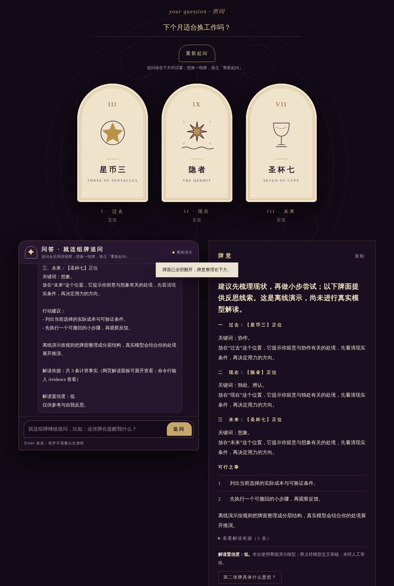
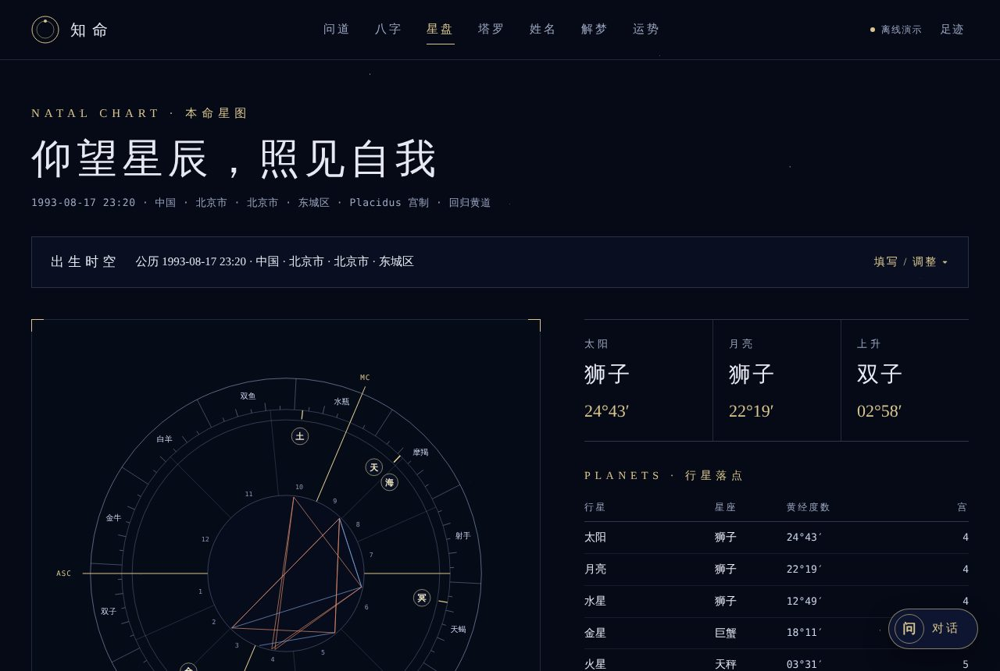
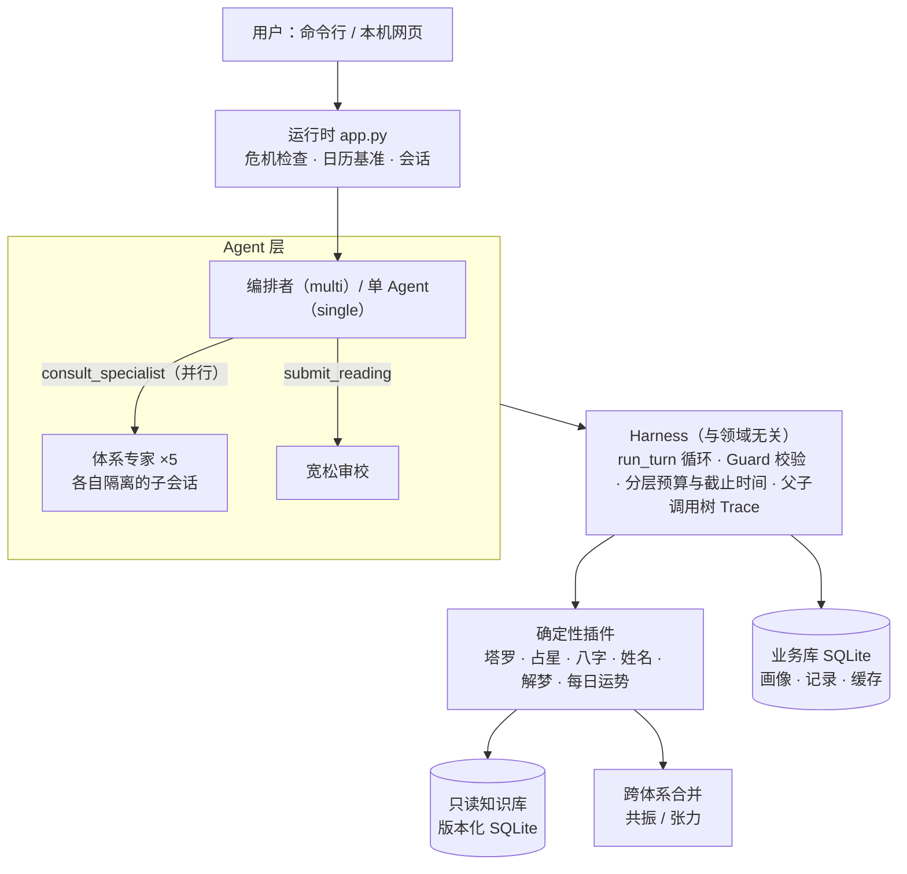

# 知命 · 事实可核验的多 Agent 命理咨询

[](https://github.com/stanGSA/ZhiMing/actions/workflows/ci.yml)


一个不依赖 LangChain、LangGraph 等框架、从循环写起的 Agent Harness，以塔罗、西方占星、八字、姓名五格、解梦和每日运势六个体系为应用场景。**排盘、抽牌、流日等事实全部由确定性代码计算，模型只负责解读；回答里引用的每一条事实都由代码逐项核对，写错就退回重写。**

选命理做场景，是因为它把大模型的两个难点放在了一起：事实部分（干支、行星落座、相位日期、牌名与正逆位）可以精确验证，模型最容易在这里编造；表达部分（分层推演、给出倾向和建议）又必须依赖语言模型。

评测结果见 [评测总表](reports/eval/summary.md)：`uv run python -m evals.report` 一条命令离线生成，不调用付费模型；真实模型的数字只读取已归档摘要，并注明模型、日期、评委与口径。

| 塔罗：从牌堆选牌、翻牌见意 | 八字：四柱、十神、藏干、五行 |
| --- | --- |
|  |  |
| **星盘：本命盘、宫位、相位** | **入口** |
|  |  |

<sub>以上为本机「离线演示」模式截图，出生资料为合成数据。四柱与星盘由程序计算；塔罗的解读文字来自离线规则演示，不代表真实模型的解读质量。</sub>

## 架构



两种运行模式共用同一套 harness 和插件：

- **single**（默认）：一个 Agent 直接调用全部工具，作为对照基线。
- **multi**：编排者不碰任何计算工具，只负责理解问题、追问和写最终解读；五位体系专家在隔离子会话里并行计算并提交结构化报告；最终回答发出前由宽松审校看一遍。

## 设计要点

- **自写 agent 循环**（[`harness/loop.py`](harness/loop.py)）：模型同一步发出的可并行工具调用用 `asyncio.TaskGroup` 并发执行，再按发出顺序把结果提交到会话状态。终止工具之后的调用不执行，但仍补齐工具响应；请求被取消时也会补齐未完成调用的响应，下一轮的消息协议始终完整。
- **Guard 先于缓存**（[`harness/guard.py`](harness/guard.py)）：每次工具调用依次检查参数 JSON、工具注册、角色权限、体系分区、schema、所需画像字段、前置依赖和自定义校验，全部通过才读幂等缓存，缓存命中不会绕过权限。工具错误以结构化结果返回给模型自行修正。
- **分层预算与准入控制**（[`harness/budget.py`](harness/budget.py)）：一次请求一个总预算，专家各有子预算。multi 模式下每次模型调用前按估算预占额度，并发的专家合计不会超支，也动不了编排者的保留额度，返回后按实际用量结算；整次请求另有墙钟上限，到期后返回的响应不再执行工具。
- **事实绑定**（各插件的 `validation.py`、[`common/validation.py`](common/validation.py)）：牌名、正逆位、干支、落座宫位、相位与日期、引用的 `ref_id` 只能来自本次工具结果，写错由代码退回。免责声明、`<br>` 这类表达层问题由 [`common/output_policy.py`](common/output_policy.py) 自动修正，不退回，避免模型越改越含糊。
- **专家隔离与状态一致**（[`agents/consult.py`](agents/consult.py)）：专家只能看到本体系的工具、释义分区和所需画像字段。成功的报告按体系原子替换信号与引用，失败的重试保留此前有效的报告；塔罗每条记录只抽一次，报告失败或请求取消都不能换牌重抽。子会话的 trace 通过 `ContextVar` 挂到发起它的那次工具调用下，可以重建完整调用树。
- **跨体系张力由代码计算**（[`signals/merge.py`](signals/merge.py)）：各体系的信号按时间区间对齐后计算共振与张力，multi 模式的最终回答必须披露每一条张力；用户偏好的体系权重只改变综合倾向，不能把分歧藏起来。
- **安全边界**（[`common/safety.py`](common/safety.py)）：识别到危机表达立即停止占卜，用户单独确认安全后才恢复咨询；求助热线按用户所在地区选择。不对健康、法律、投资、生死作确定性预测。

更细的约束、计算口径与各阶段设计见 [设计与约定](docs/design.md)。

## 关键数据

[评测总表](reports/eval/summary.md) 由一条命令离线生成，不调用任何付费模型，约 10 秒：

```bash
uv run python -m evals.report    # 写出 reports/eval/summary.md 与 summary.json；有 make 时也可用 make eval
```

**离线结果**（确定性代码与离线演示模型；标“草稿”的结果来自待审核数据集，不作验收结论）

| 项目 | 结果 | 说明 |
| --- | --- | --- |
| 参考星盘 | 11/11 通过，最大黄经误差 0.000110364° | Skyfield + JPL DE440s 独立交叉验证，最大差 0.000000611°（[第二周验收](docs/week2-验收报告.md)） |
| 八字边界 | 50/50 用例、57 个规则或追问变体通过 | 覆盖立春换年、节气换月、子时、真太阳时、夏令时、农历闰月（[第三周验收](docs/week3-验收报告.md)） |
| 姓名笔画 | 200/200 与数据集一致 | Unicode Unihan 18.0 康熙笔画；其中 19 字的金标待人工定稿（[第六周验收](docs/week6-验收报告.md)） |
| 每日运势 | 同一用户同一天跨会话 10/10 一致 | 结果按用户与日期缓存 |
| 危机识别 | 5/5（草稿） | 识别到危机表达即停止占卜，给出求助回复 |
| 高风险提示 | 代码层识别 3/25（草稿） | 只有命中关键词规则的题会被代码强制加安全说明，其余依赖模型自行标注 |
| 审校离线基线 | 漏拦 6.7%，过度干预 6.7%（草稿） | 关键词规则基线，不是 LLM 审校 |
| 工具选择 | 集合 F1 1.000，只适用 12/80 题（草稿） | 离线演示只回放塔罗题，验证流程，不代表模型的工具选择 |
| 测试 | 940 项离线测试 | Ubuntu 与 Windows CI，不调用付费模型（[测试说明](tests/README.md)） |

**真实模型**（P1 中转接口活动，20 题 × 3 次，只读[归档摘要](docs/verification/p1/README.md)）

| 日期 | 被测模型 | 版本 | 模式 | 任务完成 | 质量通过 | 严格综合 | P50 / P95 耗时 |
| --- | --- | --- | --- | ---: | ---: | ---: | ---: |
| 2026-10-25 | deepseek-v4-flash | 当前实现（Final） | single | 37/60 | 24/60 | 10/60 | 92 / 280 秒 |
| 2026-10-25 | deepseek-v4-flash | 当前实现（Final） | multi | 33/60 | 28/60 | 8/60 | 107 / 232 秒 |
| 2026-10-24 | deepseek-v4-flash | P1 前基线（B0） | single | 34/60 | 24/60 | 9/60 | 74 / 164 秒 |
| 2026-10-24 | deepseek-v4-flash | P1 前基线（B0） | multi | 37/60 | 25/60 | 14/60 | 139 / 253 秒 |

评委为 `deepseek-v4-pro`，口径 `v2-2026-10-24`；评委与被测模型同厂商，人工校准尚未完成。“严格综合”要求全部工程检查与四项回答质量评审同时通过。真实模型的端到端质量尚未通过项目自定的验收关口，因此默认仍为 single；所有失败记录都保留，没有择优替换。更早的 20 题基线（2026-10-13 gpt-6.1-sol、2026-10-20 deepseek-flash）见 [第四周真实模型测试](docs/week4-真实模型测试.md) 与 [阶段0验收](docs/verification/stage0/README.md)。

## 快速开始

需要 [uv](https://docs.astral.sh/uv/getting-started/installation/)，它会自动准备 Python 3.11 和锁定版本的依赖。

**Linux / macOS**

```bash
git clone https://github.com/stanGSA/ZhiMing.git && cd ZhiMing
uv sync --locked --extra llm --extra web
uv run python -m scripts.fetch_data   # 下载并按 SHA256 校验星历、地名与 Unihan 数据，约 70 MB
uv run python -m knowledge.build      # 构建只读知识库
uv run python web.py                  # 打开 http://127.0.0.1:8765 ，选「离线演示」即可体验
```

**Windows（PowerShell）**

```powershell
powershell -ExecutionPolicy Bypass -File .\setup.ps1   # 安装 uv、Python 3.11、依赖、数据与知识库
& .\.venv\Scripts\python.exe web.py
```

**命令行**（离线演示不需要任何密钥）

```bash
uv run python cli.py draw --question '下个月适合跳槽吗？' --spread three_card --provider demo --seed 42
uv run python cli.py draw --question 'A 公司还是 B 公司？' --spread decision --mode multi --provider demo
uv run python cli.py chat --provider demo
```

**接入真实模型**：复制 `.env.example` 为 `.env` 并填写 `DEEPSEEK_API_KEY`，默认使用 `config.yaml` 中的 `deepseek-flash`。其他 OpenAI 兼容服务设置 `OPENAI_API_KEY` 与 `OPENAI_BASE_URL`；Anthropic 设置 `ANTHROPIC_API_KEY` 并使用 `--provider anthropic --model <模型名>`。

```bash
uv run python cli.py chat                 # 单 Agent
uv run python cli.py chat --mode multi    # 编排者 + 专家 + 审校
```

**测试**

```bash
uv run pytest -q                        # 全部离线；浏览器回归需先运行 uv run playwright install chromium
uv run python -m scripts.doctor         # 环境、数据与知识库自检
```

网页功能、朋友临时体验、对话命令和隐私说明见 [使用指南](docs/usage.md)。

## 目录结构

| 路径 | 内容 |
| --- | --- |
| [`harness/`](harness/) | 与领域无关的 agent 运行时：循环、工具注册、Guard、预算、会话、trace、OpenAI/Anthropic 适配器 |
| [`agents/`](agents/) | 编排者与专家提示词、专家咨询、宽松审校、离线演示模型 |
| [`plugins/`](plugins/) | 六个确定性占术插件：计算、工具定义与输出校验 |
| [`knowledge/`](knowledge/) | 释义源文件、规则、审核账本与知识库构建 |
| [`signals/`](signals/) | 跨体系信号合并 |
| [`common/`](common/) | 公共工具、地点解析、安全与回答校验 |
| [`memory/`](memory/) | SQLite 业务库：画像、记录、缓存 |
| `app.py` `cli.py` `web.py` [`web_static/`](web_static/) | 运行时装配、命令行与本机网页 |
| [`evals/`](evals/) | 评估数据集与离线评估 |
| [`scripts/`](scripts/) | 数据下载、自检、真实模型评估、知识库审核流水线；[`scripts/archive/`](scripts/archive/) 为一次性脚本 |
| [`tests/`](tests/) | 按模块分目录的离线测试 |
| [`docs/`](docs/) | 设计、使用说明与验收记录 |

## 文档

- [设计与约定](docs/design.md)：运行路径、知识库、多 Agent、合并与审校、各插件的计算口径
- [使用指南](docs/usage.md)：网页、朋友体验、命令行、真实模型、隐私与限制
- [项目计划书](docs/占卜Agent项目计划书.md)：最初的范围、架构与评估设计
- [文档索引](docs/README.md)：各阶段验收报告与评审整改记录
- [验收材料](docs/verification/README.md)、[评估数据集](evals/README.md)
- [开发记录](CHANGELOG.md)：按时间记录的阶段状态

## 当前状态与限制

- 2026-10-22 起项目按负责人要求暂停，最后一次验证见 [中转迁移与暂停记录](docs/verification/stage1/20261022-r3-relay/report.md)。
- 知识库共 1171 条释义均为原创：451 条经双模型交叉审核，720 条为草稿，人工审核 0 条。解读置信度按所用释义的最低审核级别设上限（草稿为低，模型审核最高为中）。阶段1知识库验收未通过，见 [阶段1验收](docs/verification/stage1/20261022-acceptance/report.md)。
- 真实模型端到端质量未达到验收关口，默认使用单 Agent。
- 网页版是本机单进程服务，只监听 `127.0.0.1`；没有账号和跨设备同步，浏览器身份闲置 12 小时后自动清除。
- 所有解读仅供参考与自我反思，不是决策依据。
