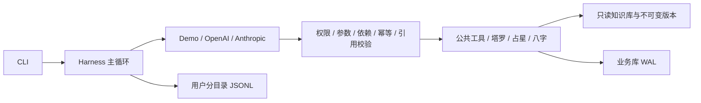

# 设计与约定

本文由 2026-10-23 之前的 README 拆出，按开发顺序记录运行路径、知识库、多 Agent 编排、跨体系合并与审校、六个占术插件的计算约定和验收方式。文中数字为当时记录（例如知识库审核状态后来有更新），当前状态以 [README](../README.md) 与 [开发记录](../CHANGELOG.md) 为准。

## 运行路径与约束



`harness/` 不引用领域插件、知识库或数据库。应用在 `app.py` 显式注册工具。塔罗计算使用版本化 SHA256 排序，不使用 Python 内建 `hash()`，可跨进程复现；抽出的牌不重复。种子由 harness 提供，模型不能换 seed 重抽。网页塔罗页让用户从背面朝上的 78 张牌里点选：种子决定整副牌的顺序，所选位置（`picks`）决定抽到哪几张；不选时取最上面的牌。所选位置随抽牌结果保存，回放校验按种子与所选位置重算。

工具错误作为结构化结果返给模型；模型故障、步数和 token 上限返回明确失败状态。两家适配器按同一口径返回结束原因与用量：Anthropic 的 `stop_reason` 映射为 OpenAI 的 `finish_reason`（`max_tokens` 与 `model_context_window_exceeded` → `length`，`tool_use` → `tool_calls`，`end_turn` 与 `stop_sequence` → `stop`，其余原样保留），输出被截断时本轮以 `output_truncated` 结束，不执行可能残缺的工具调用；`input_tokens` 是整段输入（Anthropic 另加缓存读写的部分），`cached_input_tokens` 是其中命中缓存的部分。计算后不能用普通文本绕过 `submit_reading`。同一批工具中终止工具后的调用不执行，但仍补齐工具响应，保持两家模型的协议完整。

网页的直接排盘和 MCP server（`mcp_server/`）不经过对话：调用方直接给出结构化参数，没有用户原话可供来源校验核对，因此走与会话无关的计算入口 `plugins/direct.py`。它复用各插件的计算器、事实原子与释义组装（`interpret`），不建会话、不调用运行时工具、不经过 Guard；运行时工具与 Guard 的校验不受影响。需要本人决定的事项（同名地点、新疆钟表、海外真太阳时等）同样返回 `needs_input`。

基础工具：`start_reading`、`get_profile`、`update_profile`、`read_reading`、`lookup_meaning`、`draw_tarot`、`ask_user`、`submit_reading`。用户身份由会话注入，模型不能通过参数指定其他用户。画像写入检查原话证据与字段值，支持中文日期、时刻、性别及排盘口径规范化。

## 知识库与数据

- `knowledge/sources/tarot/cards.yaml`：78 张牌 × 正逆位 = 156 条，加 7 条牌位说明，共 163 条自写草稿。
- `knowledge/sources/astro/entries.yaml`：280条占星草稿；`knowledge/sources/bazi/entries.yaml`：141条八字草稿。两个体系规则独立版本化，组合组件引用随历史记录保存。两份文件由 `scripts/draft_week23.py` 生成；感情、财务方向按传统规则起草：七颗传统行星在庙旺落陷星座及第2、5、7、8宫的落点（占星60条），十神与柱位十神（八字50条，不分性别的简化），有方向的条目同时写明对应文字。外行星与其余落点保持无方向。
- `knowledge/rules/tarot.yaml`：信号时间属性与牌位强度规则。倾向值来自条目的 `theme_map`，信号由代码产生。
- `knowledge/rules/merge.yaml`：跨体系合并的阈值（方向阈值、张力与共振强度、权重区间），和其它规则一样计入知识库版本。
- `python -m knowledge.build`：检查 schema、id、key、同义词唯一性、许可、数值范围与完整覆盖；构建只读 SQLite 和覆盖率报告（按体系统计三级审核状态）。确定性说法（排除“不代表事件必然发生”等否定式免责声明）和塔罗正逆位同号等代码检查结果写入 `data/kb.checks.json`，作为待审队列，不使构建失败。
- `data/kb_versions/<版本>.sqlite`：保留不可变条目与规则快照。版本摘要同时包含源文件、规则与审核账本（`knowledge/reviews/`）；旧 reading 的查询使用旧快照，旧快照与旧记录里没有审核级别的条目和信号按 `reviewed` 读作草稿。
- **审核状态分三级：`draft`（草稿）、`model_reviewed`（经模型交叉审核，未经人工审核）、`human_reviewed`（人工审核）。** `reviewed` 只表示人工审核，任何代码与脚本都不写它；模型交叉审核记在 `knowledge/reviews/<体系>.yaml` 账本里，按条目内容哈希绑定，内容一改即回到草稿。解读的置信度按用到的最低级别设上限：草稿为 low，说明“释义未经审核”；经模型交叉审核最高 medium（阶段1待确认），说明“释义经模型交叉审核，未经人工审核”；人工审核不设上限。**当前 1171 条全部是草稿，人工审核率 0%，模型交叉审核率 0%，解读仍强制低置信度。** 知识库关口按《项目完善计划书》4.8 的模型交叉审核指标验收（`scripts/model_review_kb.py`），尚未运行真实审核。审核方不能与起草条目的模型同厂商：感情、财务方向由 Anthropic Claude 起草，`kb_review.drafter_vendors` 记为 `anthropic`，审核脚本据此拒绝 Anthropic 审核方。
- `data/app.db`：画像与历史版本、readings、reading_responses、daily，以及后续专家、审校和排盘缓存的表结构。当前启用画像、三体系reading与追问回答、专家报告、审校意见（review_notes）和chart_id/bazi_id缓存；readings 另存保存时的跨体系合并表（merge_json）。自动迁移至schema版本4，旧行与知识版本保留。
- `runs/<用户摘要>/<会话>.jsonl`：工具参数、结果、错误、时间和 token 使用量；模型异常只记录异常类别，避免 SDK 错误文本泄露凭据。
- `evals/cases/` 和 `evals/generators/` 从用户提供的评估数据集复制，保留原稿状态，不改参考答案。

SQLite FTS5 已构建并检查可用；第一周精确查找不依赖分词或向量检索。解梦意象另建字二元组 FTS5 表（`dream_fts`）做 BM25；jieba 分词与 sqlite-vec 向量检索尚未使用。`scripts/fetch_data.py` 支持 HTTPS、SHA256 校验、缓存与目录边界检查；清单已固定七项数据（第六周新增三个 Unihan 文件）的来源、许可、版本与SHA256。地名数据改用geonamescache 3.0.2发布归档中的GeoNames cities15000固定快照（只读取JSON，不安装或执行归档代码），固定URL与SHA256；旧快照仍保留本地。CI先下载并核验全部数据，再运行doctor和测试。

## 测试和验收

```powershell
& .\.venv\Scripts\python.exe -m scripts.doctor
& .\.venv\Scripts\python.exe -m scripts.doctor --api
& .\.venv\Scripts\python.exe -m pytest -q --junitxml=reports/week1-tests.xml
& .\.venv\Scripts\python.exe -m evals.run --suite week1
& .\.venv\Scripts\ruff.exe check harness agents common plugins knowledge memory signals scripts tests evals app.py cli.py
& .\.venv\Scripts\ruff.exe format --check harness agents common plugins knowledge memory signals scripts tests evals app.py cli.py
```

测试覆盖确定性抽牌、完整释义、知识库历史版本、权限与分区、依赖、画像证据、重复调用、输出引用和事实检查、预算、异常、追问、用户隔离、删除数据，以及两家 SDK 的 HTTP 协议。

`evals.run --suite week1` 只跑原 80 题中适用于已接入塔罗的 12 题，其余 68 题跳过；自动保留每题 trace。工具集合 F1 是离线演示模式的流程指标，原数据集仍需人工审核。报告输出到 `reports/week1-eval.md` 与 JSON。跨平台 GitHub Actions 配置已添加，运行结果以仓库 Actions 为准。本地生成的 reports/、runs/ 和 data/ 不纳入版本控制；随源码归档的脱敏汇总位于 docs/verification/。

## 第四周：多 Agent 模式

`config.yaml` 的 `mode` 可选 `single` 或 `multi`，命令行用 `--mode` 覆盖：

```powershell
& .\.venv\Scripts\python.exe cli.py chat --mode multi
& .\.venv\Scripts\python.exe cli.py draw --question 'A 公司还是 B 公司？' --spread decision --mode multi --provider demo
```

- **分工**：编排者负责读画像、解析地点、选择专家、合并追问和写最终回答，自己不能调用任何排盘或抽牌工具。占星、八字、塔罗专家各在隔离子会话中只用本插件工具和本分区释义，用 `submit_report` 返回结构化报告（answer、带 ref_id 的 points、missing、confidence）。信号由 harness 从计算结果附加，专家改不了。
- **并行**：编排者在同一步发出的多个 `consult_specialist` 并发执行（上限 `max_parallel_specialists`），结果按调用顺序并入当前记录。readings 和 specialist_reports 只由编排者写入。
- **约束**：
  - 编排者写的子问题不算用户原话，出生资料仍按用户原话核验；
  - 专家需要补充资料时由编排者统一追问，追问结果不缓存；
  - 专家超时、异常或预算用尽时返回失败报告，最终回答不能把该体系列入 `systems_used`，必须在置信度说明里写明缺少哪个体系；
  - 同一体系重试失败时保留仍有效的报告（标记 `retained_previous`）。新解读提交前核对专家所依赖的画像字段快照，出生资料等依赖更正后必须重新咨询所有受影响的专家；只更新姓名不使排盘失效。成功报告按体系原子替换信号、引用和计算事实，历史记录追问继续使用原快照；
  - 塔罗在同一记录内只抽一次：抽牌成功即在当前会话保留牌面和牌阵，随后报告失败、请求取消或超时都不能换牌阵重抽。连续重试沿用原计算快照；未提交的会话状态不提供进程重启恢复。见[合并后状态恢复修复](week4-合并后状态恢复修复.md)；
  - `read_reading` 恢复历史记录时同时恢复该记录的专家报告，不带入当前记录的状态；
  - 追问原记录不再咨询专家。
- **预算**：一次请求一个预算（`request_token_budget`），编排者与专家共享；每位专家另有 `specialist_token_budget`、`specialist_timeout_s`、`specialist_max_steps`。当前数值是初值，需按真实运行重新标定。
  - 多 Agent 模式采用准入控制：每次模型调用前按输入估算加 2048 输出额度预占，并发专家不能合计超出剩余额度，也不能占用 `orchestrator_reserve_tokens`；返回后按实际用量结算。这是软上限：实际用量超过估算的部分记为 `budget_overrun`，只有这部分超额可能挤占保留额度。单 Agent 模式不做估算，与前三周相同。
  - 多 Agent 模式的 `request_timeout_s` 是整次请求的墙钟上限：等待中的模型调用、专家执行与排队、异步工具都在到期时取消，到期后返回的响应不执行工具，结果为 `timeout`。排盘等同步计算不能中途打断，算完后才响应取消。单 Agent 模式不加墙钟上限。
- **trace**：子会话写各自的 JSONL，带 `parent_session_id` 和 `parent_call_id`，创建即记 `session_started`，正常、超时或取消都记 `session_finished`；父会话记录 `specialist_queued`、`specialist_started`（获得并发许可后）和 `specialist_finished`。`python -m scripts.trace_tree --user <用户> --reading <记录>` 重建调用树并检查完整性。
- **评估**：
  - `python -m evals.run --suite week1 --mode multi` 是 demo 模型的离线流程回放；
  - `python -m scripts.archive.live_v2_review --suite baseline --mode multi` 用真实模型串行跑 20 题，结果附带专家越权、报告合规率（≥98% 关口口径）、首次通过率、修正后通过率、实际并发度、排队时间和调用树完整性。指标口径见 [第四周验收](week4-验收报告.md)，原始完整批次、评审服务错误和独立复评见[真实模型测试](week4-真实模型测试.md)，不拼接通过率。


## 第五周：交叉解读与审校

- **信号合并（`signals/merge.py`）**：
  - 先按 horizon 分组，再按主题合并；不同 horizon 不互相抵消。
  - 每个体系在组内按 strength 加权求平均倾向；`theme_map` 里的 0 表示“无方向”，不参与平均。
  - 两体系方向相反、且两边同向信号强度都 ≥ `tension_strength` 时记为张力；至少两个体系同向记为共振。
  - timing 信号按实际时刻区间求交集再比较：节气流月在节气当刻换月，行运按当天，不按“11 月”这类标签对齐。
  - 同一主题、同一组方向是一条张力（编号如 `tension:timing:career:astro+/bazi-`），下面列出所有窗口；方向反过来的日期是另一条。
  - 相邻窗口合并时，数值按时长加权，每段原值保留在 `segments`。
  - 画像里的 `system_weights`（如 `{"bazi": 1.5}`）只改变综合倾向，不改变是否存在张力。
  - 权重必须有原话支持：原话按分句判断，每个体系只看提到它的分句，否定说法（“不更信八字”）不支持任何调整。
- **张力披露（多 Agent 模式，代码检查）**：
  - 编排者用 `merge_signals` 查看合并表。
  - `submit_reading` 时，表里每条张力都必须写进 `tensions`：主题对得上，两边体系都要提到，还要有 `how_to_read`。同一主题在不同日期方向相反时，还要写出各自的日期。缺了直接打回，并列出未披露的张力和日期。
  - 合并表随 reading 存入 `merge_json`。追问时 `read_reading` 把它固定为会话快照，`merge_signals` 只返回快照，不按当前权重或规则重算；追问回答也不能丢掉原记录的张力。
  - 单 Agent 模式只保存合并表、不强制披露，作为对照基线。
- **宽松审校（`agents/reviewer.py`，只在多 Agent 模式）**：
  - **自动运行**：`submit_reading` 通过代码校验后，自动交给隔离子会话里的审校，编排者无法跳过。
  - **输入**：审校只看用户原问题、草稿和代码算出的张力/共振表。
  - **结论**：三档，即 `pass`、`pass_with_notes`（不触发重写）、`revise`。`revise` 只能以答非所问、隐瞒张力或安全越界为理由，并须逐字引用草稿原句。
  - **轮次上限**：最多一轮 `revise`，编排者改一次后直接发出。
  - **代码兜底**：要求加免责声明或“措辞更谨慎”的 `revise` 会被拒绝，这类 notes 被丢弃并计数。审校不能要求删掉对问题的回答；没有张力时不能以隐瞒张力打回。
  - **失败放行**：审校超时、出错或预算不足时放行，记为 `unavailable`。
  - **记录**：审校意见写入 `review_notes`，trace 中是 reading 下的子会话。
  - **配置**：`reviewer.strictness` 可设为 `lenient`、`strict` 或 `off`（对照实验用）；`models.reviewer` 可换更小的模型。
  - **追问**：追问不重新审校。
- **画像复用**：
  - 画像已有性别、出生日期或出生地时，`ask_user` 不能再问这些。例外是本轮有工具要求补充资料，或用户正在更正。
  - 跨会话回访用 `start_reading(parent_reading_id=...)` 关联本用户的旧记录，并返回旧结论、时间范围和张力，供对比。
- **评估**：
  - `python -m evals.run --suite reviewer --provider deepseek` 用 `reviewer_drafts.yaml` 45 份草稿测漏拦率（≤10%）和过度干预率（≤5%）。
  - `--provider demo` 是离线关键词基线，只验证流水线，不是关口结果。
  - 多 Agent 真实模型运行的结果附带审校打回率等指标（`scripts.trace_tree.reviewer_metrics`）。

## 第六周：姓名、解梦与每日运势

- **姓名五格（`plugins/name/`，工具 `analyze_name`）**：
  - 笔画：Unicode Unihan 18.0（`kRSUnicode`、`kTraditionalVariant`、`kTotalStrokes`，由 `scripts/fetch_data.py` 按固定提交与 SHA256 下载到 `data/unihan/`）。先取繁体字形（姓氏有繁体惯例覆盖），再按“部首原字笔画 + 余笔”计康熙笔画，氵按水 4 画、艹按艸 6 画、左阝按阜 8 画等由部首号自动体现；数字一至十按数值计。
  - 五格：天格（单姓加假数 1，复姓两字相加）、人格、地格（单名加假数 1）、外格 = 天格 + 地格 − 人格、总格；数理超过 81 减 80。三才按天人地格尾数定五行。常见复姓自动识别，“欧阳子涵”不能被拆成“欧 / 阳子涵”。
  - 写法有歧义的字（杰 / 傑、强 / 強、郁 / 鬱、肖 / 蕭 等 9 个）返回默认写法、备选笔画与 `confirmation_prompts`。只要计算结果里有未确认的写法，回答就必须在实际显示的文字中将各字形与笔画逐一配对、说明默认方案并请用户确认；工具生成的确认文案可直接放入 advice，只写在隐藏的 confidence.reason 不算披露。用户确认后用 `forms` 传入。复姓“万俟”保留“万”（3 画），单姓“万”默认“萬”（15 画）。Unihan 查不到的字返回 needs_input，不猜笔画。
  - 五格、三才和笔画陈述按姓名绑定：evidence 按 ref 对应到具体名字，正文按前面最近写出的全名对应；同时分析两个名字时，没有写明是哪个名字的格数会被打回，不能串用另一个名字的数值。
  - 姓名必须来自用户原话或画像 `name`。用户要求结合八字时传入本记录的 `bazi_id`，把三才五行与原局五行计数放在一起分析；补益五行属传统推断，须说明依据，不作命运断言。
  - 信号只有 `trait`，强度上限 0.35，低于八字和本命盘。天格来自姓氏，不单独产生倾向。起名、合婚属第二阶段。
- **解梦（`plugins/dream/`，工具 `lookup_dream_symbols`）**：
  - 知识库 355 条意象（覆盖 `dream_annotations.yaml` 的 89 个种子意象），每条带同义词；数据集里用作“词典外”探针的无人机、外卖、直播等刻意不收录。
  - 模型从梦境描述抽出意象后调用工具，每项带用户原文的连续片段（`phrase`）和规范意象（`symbol`）。片段必须逐字来自用户描述；规范意象必须由片段写出，或是片段的受控缩写（“牙齿一颗一颗掉下来”→掉牙），词典外的词须照抄原文，“手机”不能报成“飞机”。匹配顺序：同义词表精确命中 → 包含匹配（已知意象须位于短语末尾，例如“大狗”→狗，而“地铁闸机”不算地铁）→ FTS5 BM25（中文按字二元组索引）取候选、Dice 相似度 ≥ 0.75 才接受。向量检索兜底尚未启用（没有安装 embedding 模型），低于阈值一律记为未命中。
  - 代码检查覆盖所有对外文字（含 timeline）：未命中的意象只能说明“未收录、不解读”，该说明只豁免对应意象，不能豁免同句中的其他解读；任何作为解读对象的知识库意象（“梦见X”“X象征/代表/意味……”“「X」”，带不带引号都一样）必须是本次命中的；不能把梦说成预兆或预言（“不预示”“不代表”这类否定说法允许）；只用解梦的回答不写 timeline。
  - 信号只进入 `psyche`，合并时不与时机或运势信号互相抵消。
- **每日运势（`plugins/daily/`，工具 `daily_fortune`）**：
  - 不设专家，编排者直接调用一次；在代码里组合三个插件：当天月亮、太阳、水星、金星、火星对本命行星的精确相位，流日干支与日主的十神和冲合，以及每日一牌（种子为 SHA256(用户编号, 日期) 的前 8 字节）。
  - 结果写入 `data/app.db` 的 `daily` 表，主键 (user_id, date)。同一用户同一天再问直接读缓存，工具返回的计算数据逐字节不变，同时保留当时的知识库版本；出生资料更正后才重新计算。模型据此写的文字不保证逐字相同。
  - 日期必须与用户所问一致（今天、明天、后天或明确日期，按 Asia/Shanghai 日历基准）。本次提问以来的所有用户消息都算：出生资料里的日期（“我出生于1996-05-10”或等于画像生日）不算咨询日期；只补充出生资料不会改变已问的日期，用户明确说新日期才改变；不存在的日期（如 2026-02-30）返回可恢复的校验错误。目标日期保存在本记录的 `daily_target_date`。一周及以上按时机题处理。缺出生资料返回 needs_input。
  - 牌名与正逆位、流日干支和相位分别由塔罗、八字、占星的输出检查核对；每日一牌和普通抽牌一起进入正逆位检查，所有对外文字都查，追问恢复记录后同样适用。幸运色只能说是流日天干五行的传统配色约定。
- **多 Agent**：新增姓名、解梦两位专家，各自只看本插件工具和本分区释义。结合八字看名字时，编排者先咨询八字专家，再咨询姓名专家；姓名专家继承本记录的 `bazi_id`。
- **评估**：
  - `python -m evals.run --suite week6`：200 字笔画、37 个公认姓氏、五格手算样例、每日运势跨会话 10 次一致与同 seed 抽牌 100 次一致、三个新分区的覆盖率，以及解梦词典的离线扫描基线。
  - `python -m evals.run --suite trajectory`：标注路线回放扩展到全部 80 题（含 H_dream 历史）。它不是模型自主选工具的 F1。
  - `python -m scripts.archive.review_week6_datasets`：记录 19 个待定稿字的处理，并对解梦数据集做结构审核（不是人工审核）。

## Week2 / Week3 用法与计算约定

在 `cli.py chat` 中提供合成资料，例如“公历1993-08-17 23:20，北京出生，男性；按23点换日、不用真太阳时，用八字说明日主、起运日期和首步大运”。时机题请给明确区间，例如“2026-11-01至2026-11-30，用占星和八字分析求职安排”。CLI 的 demo 模式仍是塔罗规则演示；三体系自然语言对话需真实模型，确定性计算测试完全离线。

新增工具：`resolve_location`、`compute_natal_chart`、`compute_transits`、`compute_bazi`、`compute_bazi_period`。先解析地点，再凭chart_id/bazi_id计算流期；同名城市、缺少出生资料、农历闰月、DST重复时间均追问。乌鲁木齐等新疆地点须确认北京时间或新疆时间。已有原局可跨会话复用；记录与缓存绑定当前用户。

- 占星：地心视位置、日期回归黄道；TT算行星、UT1算宫位。Placidus无定义时回退Porphyry。未知时辰用中午代理，宫位与四轴为null；月亮和行运精确日期需保留时间不确定性。
- 星历支持1800–2399；独立DE440s覆盖1849–2150，本次独立验收仅声称11个参考盘。行运支持最多3660天，输出精确相位过零/接触事件、残差与允许容许度；不是“任意时刻仍在容许度内”的逐日列表。给模型最多12条事件，完整计算保留本地，明确省略数量。
- 八字验收日期1900–2100：IANA消除夏令时后转固定UTC+8；开启真太阳时再做经度与均时差修正。立春换年、十二节换月依据物理时刻；日时遵循`next_day`（23点换日）或`same_day`（0点换日）。已有画像中的这两个开关可以复用。
- 起运默认沿用参考集的lunar_python getYun流派1及civil修正钟表口径，三天折一年、时辰差折算月日；不同流派可能相差数月。真太阳时钟表跨节气时要求确认`dayun_time_basis=physical`（物理时刻起运）或暂不排大运，不静默改变顺逆。工具返回明确口径。未知时辰不排精确大运，缺性别不排大运；程序不计算喜用神，解读可据月令与五行分布推断喜用倾向并说明依据。
- 流期支持年/月/日；年最多3660天，月/日最多366天。按实际立春、节气与日界分段。日期结束日包含，带时刻的结束点为半开区间。十神与原局冲合刑害破、三合三会是符号关系，不等同于必然事件。
- 占星信号按容许度与速度确定强度；组合释义及所有组件引用固定于知识版本。八字按十神、柱位、冲合规则产出信号。人工审核率0%，仍未达到发布前≥95%审核门槛。

当前 DeepSeek 使用 `llm.system_role: system`，三个角色均为 `deepseek-flash` 非思考模式，单次输出上限分别为8192、4096、2048 token。`model_options` 按角色覆盖 `llm.deepseek` 设置，角色使用独立客户端。适配器保留各轮 `reasoning_content`，trace只记录思考用量和结束原因；输出截断时停止，不执行不完整工具调用。可运行 `python -m scripts.check_model` 核对当前配置。服务返回名称单独记录，不能证明底层模型身份。三体系单轮预算180000个返回usage token、最多12步，超限明确失败；多 Agent 模式下该预算由编排者和专家共享。

八字证据附录将流期明确渲染为流年、节气流月、流日或流时，原局柱位只与出生盘比较，流期柱位与对应层级的流期计算比较；旧版 `period:…:年柱:…` 证据仍能读取。校验错误包含字段位置和正确原局值。工具返回参数或校验错误时附带修正指引；同一轮中，同一工具、错误码和错误信息累计三次相同失败后以 `validation_stalled` 结束，成功调用该工具则清零。失败的终止提交草稿保留在会话状态和恢复快照中，`read_reading` 可读取尚未入库的当前记录；同轮提交失败后禁止以 `start_reading` 清空计算。下一轮可复用当前计算继续修正，不发布未经校验的草稿。

## Week2 / Week3 可复现验收

```powershell
$env:PYTHONUTF8 = '1'
& .\.bootstrap\Scripts\uv.exe sync --locked --extra llm
& .\.venv\Scripts\python.exe -m scripts.fetch_data
& .\.venv\Scripts\python.exe -m knowledge.build
& .\.venv\Scripts\python.exe -m scripts.doctor --api
& .\.venv\Scripts\python.exe -m pytest -q --junitxml=reports/week23/pytest-final.xml
& .\.venv\Scripts\python.exe -m scripts.archive.verify_week23
& .\.venv\Scripts\python.exe -m evals.run --suite week1 --output reports/week23/week1-regression
& .\.venv\Scripts\python.exe -m evals.run --suite trajectory --output reports/week23/offline
& .\.venv\Scripts\python.exe -m scripts.live_test --model gpt-6.1-sol --output reports/week23/week1-live
& .\.venv\Scripts\python.exe -m scripts.live_week23
& .\.venv\Scripts\ruff.exe check harness agents common plugins knowledge memory signals scripts tests evals app.py cli.py
& .\.venv\Scripts\ruff.exe format --check harness agents common plugins knowledge memory signals scripts tests evals app.py cli.py
& .\.bootstrap\Scripts\uv.exe build --out-dir reports/week23/dist
& .\.venv\Scripts\python.exe -m scripts.archive.archive_week23
```

真实测试会产生服务调用与费用，原始记录仅在已忽略目录。`live_week23`逐条检查正面作答、时间范围、计算及引用支持、事实编造，评审也使用同一请求模型；不是独立人工审核。`trajectory`只对当前适用的50题做标注路线集成回放，30题因后续工具或解梦历史跳过，不能当作真实模型工具选择F1。没有执行的全80题真实轨迹、完整30题安全集、独立人工万年历抽查和发布审核均不声明通过。
