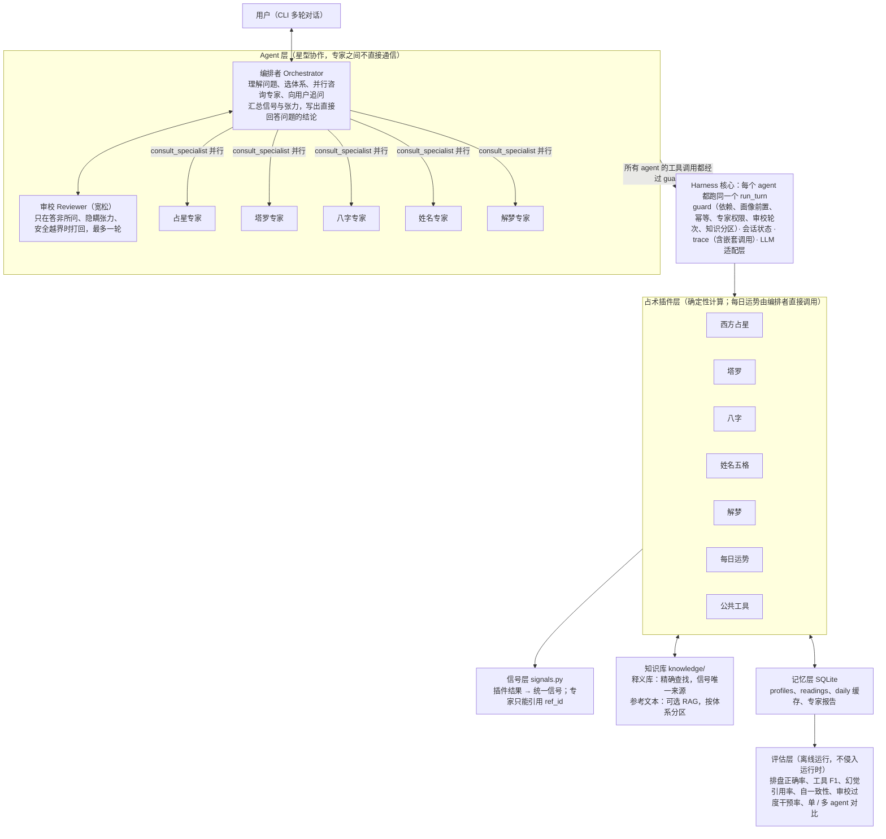

# 占卜 Agent Harness 项目设计

2026-10-13

## 项目定位与范围

这是一个手写的极简 agent harness，垂直场景是多体系运势咨询：西方占星、塔罗、八字、姓名五格、解梦和每日运势。功能范围参考了 [chatgpt-tarot-divination](https://github.com/dreamhunter2333/chatgpt-tarot-divination)（MIT 协议，提供塔罗、八字、姓名五格、周公解梦、起名、梅花易数、姻缘等入口）。区别在于，它按占卜类型分别提供功能入口；本项目由一个 agent 根据问题自行组合多个体系，并做跨体系交叉解读。

运行时采用多 agent 协作：一个编排者负责理解问题和汇总，五个体系专家并行解读各自体系，一个宽松的审校 agent 在发出前做一次语义把关。项目卖点是五件事：确定性工具负责计算、排盘和抽牌；agent 之间只传结构化结果；harness 在代码层管住流程和权限；审校只拦真正的问题，不削弱回答；评估套件把一致性量化成数字。

**MVP 包含**

- 中文 CLI 多轮对话（Web UI 留到最后，可选）
- 六个占术插件：西方占星（本命盘、行运）、塔罗、八字（四柱、十神、大运流年）、姓名五格、解梦、每日运势（组合前几个插件）
- 集中管理的知识库：结构化释义库约 1100 条，按 key 精确查找，是信号的唯一来源；参考文本 RAG 为第 7 周可选项
- 多 agent 协作：编排者 + 5 个体系专家 + 审校 agent，同时保留单 agent 模式作为对照基线
- 跨体系交叉解读：同一问题可同时用东西方体系，并显式处理两边的分歧
- 长期用户画像 + 每次占卜的完整记录（reading）
- 一套可重复运行的评估脚本，README 里直接放指标数字

**非目标**：吠陀占星、紫微斗数、专家之间的自由对话或辩论、付费与账号系统、语音。梅花易数、起名、合婚 / 合盘列为第二阶段，插件接口稳定后再加。

**默认技术假设**（可改）：Python 3.11；不用 LangChain / LangGraph 等框架，自己写循环；LLM 走一层薄适配，可切换 OpenAI 兼容接口或 Anthropic SDK；存储用 SQLite。

**安全边界**：不对健康、法律、投资、生死做确定性预测；所有输出定位为“参考与自我反思”，不是指令。这条既是伦理要求，也是评估里的一个可测指标。

## 整体架构

系统分七层：最上面是 agent 层（编排者、5 个体系专家、审校），所有 agent 都跑在同一个与占卜无关的 harness 上；占术插件层全部确定性；知识库存放所有用户共用的领域释义；信号层把各体系结果统一成可合并的结构；记忆层存每个用户自己的画像与记录；评估层只读 trace 和记录。



以“下个月适合跳槽吗”为例，一次请求的数据流：

1. 编排者读取画像，发现已有姓名、性别和出生信息，不再追问。
2. 编排者判断这是时机类问题，在同一步里并行咨询三位专家：占星专家（本命盘 + 下个月行运）、八字专家（原局 + 下个月流月）、塔罗专家（三张牌阵）。专家各自调用本插件工具，每次调用都过 guard。
3. 插件按知识库的释义条目和组合规则生成信号；专家只能查本体系分区的条目，据此写要点。
4. 每位专家返回结构化报告：本体系信号、带 ref_id 的要点、本体系对问题的一句话回答。
5. 编排者用 `signals/merge.py` 合并三份报告，占星和八字结论相反的地方标为“张力”，然后写出草稿，第一句直接回答“适不适合”。
6. 审校 agent 检查草稿：答到点子上、张力已披露、没有安全越界，判定通过。
7. `submit_reading` 经 guard 校验引用后返回给用户；reading（含知识库版本号）和专家报告入库，trace 记录完整的嵌套调用。

## 工具清单

工具按“占术插件”组织：6 个插件加一组公共工具。每个插件自带工具、信号抽取器和评估用例，释义数据统一放在 `knowledge/`，插件通过 `kb_partition` 声明自己使用哪个分区。新增占术只需加一个插件目录和一个知识分区，harness 一行不改。计算类工具全部是纯函数、可复现，LLM 永远不自己“编”排盘或牌面。

```python
class DivinationPlugin(Protocol):
    name: str                      # "bazi"
    tools: list[Tool]              # 注册给 LLM 的工具（Pydantic schema）
    required_profile: set[str]     # 如 {"birth_datetime", "birth_lon", "gender"}
    themes: set[str]               # 该体系能给出信号的主题
    kb_partition: str              # 知识库分区，如 "bazi"
    eval_dir: Path                 # 插件自带的评估用例
    def extract_signals(self, results: list[ToolResult]) -> list[Signal]: ...
```

| 插件 | 工具 | 关键输入 | 关键输出 | 约束 |
| --- | --- | --- | --- | --- |
| 公共 | `get_profile` / `update_profile` | user_id；field, value, evidence | 画像；新版本号 | evidence 必须是用户原话子串 |
| 公共 | `resolve_location` | 地名文本 | 经纬度、IANA 时区，或多个候选 | 有歧义时交给 `ask_user` |
| 公共 | `lookup_meaning` | system, kind, key | 知识库条目，ref_id 带版本号，如 `kb:tarot:the_tower:upright@v3` | 精确匹配；查不到返回“缺条目”，不做模糊兜底 |
| 公共 | `search_reference`（第 7 周可选） | 查询文本, top_k | 参考段落及其 ref_id | 只给专家用；体系分区由 harness 强制注入；不产生信号 |
| 公共 | `ask_user` / `submit_reading` | 问题；结构化 JSON | 结束本轮；校验结果 | 每轮最多追问一次；输出未过校验会被打回 |
| 西方占星 | `compute_natal_chart` | 出生本地时间、时区、经纬度、time_known | chart_id、行星落座与宫位、四轴、相位 | 出生时间未知时宫位和四轴为 null |
| 西方占星 | `compute_transits` | chart_id、起止日期 | 行运事件：相位、精确日期、容许度、触发的本命宫位 | 必须已有 chart_id |
| 塔罗 | `draw_tarot` | spread, question | 牌位、牌名、正逆位、seed | 同一问题只抽一次 |
| 八字 | `compute_bazi` | 出生本地时间、经度、性别、真太阳时开关、子时规则 | bazi_id、四柱干支、日主、五行计数、十神、藏干、纳音、大运起运与排列 | 时辰未知只排三柱；缺性别不排大运 |
| 八字 | `compute_bazi_period` | bazi_id、起止日期、粒度（年 / 月 / 日） | 流年、流月、流日干支，及其与日主的十神关系、与原局的冲合 | 必须已有 bazi_id；流月按节气划分 |
| 姓名五格 | `analyze_name` | 姓、名、可选 bazi_id | 每字康熙笔画、天人地外总五格与 81 数理、三才五行；有 bazi_id 时附名字五行与原局五行计数对照 | 复姓按复姓规则计算 |
| 解梦 | `lookup_dream_symbols` | LLM 从梦境描述中抽出的意象列表 | 命中的知识库条目、未命中列表 | 同义词表 → BM25 → 向量检索依次匹配；低于阈值记为未命中，不解读 |
| 每日运势 | `daily_fortune` | user_id、日期 | 当日月亮与快行星对本命的相位、流日干支与日主关系、每日一牌 | seed = hash(user_id, 日期)；在代码里组合其他插件，不经 LLM |

**八字的确定性陷阱**：年柱以立春换年、月柱以节气换月，都不是农历初一；23–24 点的子时归属有“早子 / 晚子”两种规则，做成配置项并写进画像；是否按出生地经度修正为真太阳时，也做成开关。喜用神的判断流派分歧大，MVP 只输出五行计数和十神，不下“喜用神”结论。

**牌阵**：MVP 支持单张、三张、二选一决策阵；凯尔特十字放到第二阶段。各体系释义的来源、规模和构建方式见下一节“知识库”。

## 知识库

知识库集中放在 `knowledge/`，以结构化释义库为主体、按 key 精确查找，它是信号和 ref_id 的唯一来源；参考文本 RAG 是第 7 周的可选项，只帮专家补充解读深度，不改变结论方向。知识库存的是所有用户共用的领域知识，和存每个用户自己信息的“记忆”是两回事。

**两层结构**

| 层 | 内容 | 检索方式 | 谁能用 | 是否影响信号 |
| --- | --- | --- | --- | --- |
| 结构化释义库（MVP） | 原子条目 + 主题映射与组合规则 | 按 key 精确查找 | 插件代码、专家、编排者（回答追问时） | 是，唯一来源 |
| 参考文本库（第 7 周可选） | 自写白话摘要，标注古籍出处，切块存储 | BM25 + 向量混合检索 | 只有专家 | 否 |

为什么主体不用 RAG：牌名、十神名、行星落座这类查询的 key 本来就是确定的，精确查找 100% 命中，还能直接给出 ref_id；换成向量检索反而会查到“相近但不对”的条目，破坏一致性。真正需要模糊匹配的只有解梦意象。

**条目 schema**

```json
{
  "id": "kb:bazi:shishen:qisha",
  "system": "bazi",
  "kind": "shishen",
  "key": "七杀",
  "synonyms": ["偏官"],
  "keywords": ["压力", "竞争", "魄力"],
  "theme_map": {"career": -0.3, "self": 0.2},
  "text": "两三句自写白话释义",
  "source": "自写；参考《渊海子平》",
  "license": "本项目自写",
  "reviewed": true,
  "version": 3
}
```

**原子条目 + 组合规则**：行运相位如果每种组合写一条（行运星 × 相位 × 本命点），会有上千条。知识库只存原子条目（行星性质、相位性质、本命点主题），由代码按 `rules/*.yaml` 组合出信号；八字的十神 × 柱位同理。规则文件和条目一样有版本号。

**首版规模**

| 体系 | 条目内容 | 数量（估） |
| --- | --- | --- |
| 塔罗 | 78 张牌 × 正逆位、牌阵牌位 | 约 170 |
| 西方占星 | 行星 × 星座、行星 × 宫位、星座 / 宫位 / 相位基础条目 | 约 280 |
| 八字 | 天干、地支、十神、五行生克、冲合刑害、纳音、十神 × 柱位 | 约 140 |
| 姓名五格 | 81 数理、125 种三才组合 | 约 210 |
| 解梦 | 意象条目，每条带同义词 | 300 |
| 合计 |  | 约 1100 |

**检索策略**

- 精确查找：key 或同义词必须完全匹配；查不到返回“缺条目”，不做模糊兜底，并计入覆盖率报告。
- 解梦意象：同义词表命中直接返回；否则用 BM25（jieba 分词）+ 向量检索，相似度低于阈值记为未命中，不解读。
- 参考文本（可选）：按体系分区切块，每块 300–500 字，混合检索取 top-3；专家引用必须带段落 ref_id。

**分区与权限**：每位专家只能查自己体系的分区，由 harness 在注册工具时注入过滤条件，和多 agent 的上下文隔离是同一套机制；编排者只能用 `lookup_meaning`，不能用 `search_reference`。

**来源与版权**

- 只存自写的白话内容，标注参考出处（如韦特 1910 年的塔罗原著、《渊海子平》《三命通会》），不存古籍原文。
- 禁止抓取现代网站、书籍整理版和 App 文案。
- 每个条目都有 license 字段，构建时自动检查。

**构建流程**

1. YAML 源文件按体系放在 `knowledge/sources/`，纳入 git 管理。
2. 用 LLM 批量起草条目，人工审核后把 `reviewed` 设为 true；未审核条目参与解读时，置信度降一级。
3. `build.py` 校验 schema 和 id 唯一性，输出覆盖率报告，编译成 SQLite（FTS5 做 BM25）和向量索引，并打上知识库版本号。
4. 每条 reading 记录当时的知识库版本。条目更新后，旧 reading 仍按旧版本解析，追问时不会出现“同一张牌含义变了”。

## Agent 循环与决策策略

“调哪些工具”由 LLM 决定，“能不能调”由 harness 决定。编排者、专家、审校跑的是同一个循环，区别只在 system prompt、可见工具和步数上限。循环本身很短：LLM 产出 tool call，harness 校验后执行，结果追加回上下文；遇到 `submit_reading` 或 `ask_user` 结束本轮，编排者步数上限默认 12，专家 6。

```python
def run_turn(session, user_msg):
    session.append_user(user_msg)
    for step in range(MAX_STEPS):
        resp = llm.chat(session.messages, tools=registry.schemas())
        if not resp.tool_calls:
            return resp.text                      # 闲聊，直接回复
        for call in resp.tool_calls:
            err = guard.check(call, session.state)  # 依赖、幂等、重复调用
            result = err or registry.run(call, session.state)
            session.append_tool(call, result)
            tracer.log(session.id, step, call, result)
            if call.name in ("ask_user", "submit_reading") and not err:
                return render(result)
    return fallback_answer(session)              # 超步数兜底
```

**问题类型与期望工具组合**：分类由编排者在推理中自行完成，不单独训练分类器。多 agent 模式下，“期望工具组合”一列对应编排者要咨询的专家；这张表同时是评估集的标注依据。

| 问题类型 | 例子 | 期望工具组合 |
| --- | --- | --- |
| 时机类 | 下个月适合跳槽吗 | 本命盘 → 行运；八字 → 流月；三张牌 |
| 抉择类 | A offer 还是 B offer | 二选一决策阵，可选加八字流年 |
| 性格 / 天赋类 | 我适合做什么方向 | 本命盘 + 八字原局（十神、五行） |
| 今日运势 | 今天运势怎么样 | `daily_fortune` 一次调用 |
| 姓名 | 帮我看看这个名字 | `analyze_name`；画像里有八字时带上 bazi_id |
| 解梦 | 昨晚梦到掉牙 | LLM 抽意象 → `lookup_dream_symbols`；可选加单张牌 |
| 指定体系 | 只用八字帮我看看 | 只调用户指定的插件，不越界 |
| 追问 | 第二张牌具体什么意思 | 不调计算工具，只读本次 reading + `lookup_meaning` |

**Harness 层硬约束**（写在代码里，不靠 prompt）

1. 依赖检查：没有 chart_id 就调 `compute_transits`、没有 bazi_id 就调 `compute_bazi_period`，返回一条错误信息给 LLM 让它自我修正，而不是抛异常。
2. 画像前置检查：调用插件工具前对照该插件的 `required_profile`，缺什么就返回“需要追问 X”，引导编排者调 `ask_user`。
3. 抽牌幂等：同一 reading 内第二次 `draw_tarot` 被拒绝，除非用户明确要求重抽。
4. 重复调用拦截：同一工具、同一参数第二次调用直接返回缓存并提示。
5. 记忆写入校验：`update_profile` 的 evidence 必须是用户原话的子串。
6. 输出校验：`submit_reading` 和专家报告引用的 ref_id 必须是本次信号、知识库条目或检索到的参考段落之一；提到的每张牌、每个行星位置、每根干支都必须存在于本次工具结果中，否则打回重写。
7. 专家权限：每位专家的工具表只含本插件工具，越权调用直接拒绝。
8. 审校自动触发与轮次上限：多 agent 模式下 `submit_reading` 会先自动交给审校，编排者无法跳过；`revise` 最多一轮。
9. 知识分区检查：专家的知识库查询和参考文本检索一律限定在本体系分区，跨分区请求直接拒绝。

**边界情况**

- 不知道出生时间：先问一次；仍不知道就用中午 12 点起星盘、八字只排三柱，宫位、上升和时柱标为不可用，解读中禁止提及。
- 用户给的是农历生日：先确认是农历，再转换；闰月要单独确认。
- 出生地有歧义：`resolve_location` 返回多个候选，交给 `ask_user`。
- 名字含多音字、生僻字或只给了简体：按繁体字形取康熙笔画，查不到的字返回给用户确认，不猜。
- 超出范围的问题（疾病诊断、具体投资标的）：可以给反思性解读，但 `safety` 字段必须标注，并建议咨询专业人士。
- 出现情绪危机信号：中止占卜流程，转为支持性回应。这一条单独做成安全测试用例。

## 多 Agent 协作

编排者负责“问什么、问谁、怎么答”，专家负责“本体系怎么看”，审校负责“有没有答到点子上”。三者之间只传结构化 JSON，不传自由文本对话。

**角色分工**

| Agent | 职责 | 能看到的上下文 | 可调工具 | 输出 |
| --- | --- | --- | --- | --- |
| 编排者 | 理解问题、选择体系、追问用户、汇总并写最终回答 | 完整对话、画像摘要、专家报告、合并后的信号表 | `consult_specialist`（可并行）、`daily_fortune`、`lookup_meaning`（回答追问时）、公共工具、`submit_reading` | 最终 reading 草稿 |
| 体系专家 ×5 | 用本体系工具计算，按本体系知识分区解读子问题 | 子问题与时间窗、本插件所需的画像字段、本体系知识分区 | 本插件工具、本分区的 `lookup_meaning`，第 7 周起可用本分区的 `search_reference` | 专家报告 |
| 审校 | 发出前做一次语义把关 | 用户原问题、最终草稿、信号表 | 无 | 审校意见 |

每日运势不设专家：它是确定性组合插件，编排者直接调用，省掉一轮 LLM。

**专家报告 schema**

```json
{
  "system": "bazi",
  "answer": "本体系对子问题的一句话回答",
  "signals": ["由插件的 extract_signals 在代码里生成，专家不能改"],
  "points": [{"ref_id": "bazi:liuyue:2026-11:qisha", "text": "一句解读"}],
  "missing": ["出生时辰未知，时柱不可用"],
  "confidence": "medium"
}
```

**实现：子 agent 就是一个工具**

```python
async def consult_specialist(system: str, sub_question: str, timeframe: str | None):
    spec = SPECIALISTS[system]                      # 专属 system prompt + 受限工具表
    sub = Session(parent=current_session(), registry=spec.registry,
                  max_steps=6, profile_view=spec.required_profile)
    report = await run_turn(sub, spec.brief(sub_question, timeframe))
    return SpecialistReport.model_validate(report)  # 不合 schema 即判失败
```

编排者在同一步发出多个 `consult_specialist`，harness 用 asyncio 并行执行；子会话的 trace 挂在父会话下，回放时能看到完整调用树。

**协作规则**

1. 星型拓扑：专家之间不直接通信，也看不到彼此的报告，避免一个体系的结论“传染”另一个。
2. 专家权限：guard 只给专家注册本插件的工具，越权调用直接拒绝。
3. 失败隔离：某位专家超时或报告不合 schema，编排者照常用其余专家的结果作答，并在 `confidence` 里说明少了哪个体系。
4. 预算：专家最多 6 步，整次请求设 token 上限；超限时编排者用已有结果收尾。
5. 保留单 agent 模式：配置 `mode=single` 时编排者直接调插件工具，跳过专家和审校，作为评估对照基线。

**审校 agent：宽松模式**

审校的定位是“发出前最后看一眼”，不是第二个裁判。默认放行，只在三种情况下打回：

| 打回条件 | 判断标准 |
| --- | --- |
| 答非所问 | summary 第一句没有直接回应用户的问题，例如问“下个月适不适合跳槽”，却只讲性格 |
| 隐瞒张力 | 信号表里有张力，但输出只讲了其中一边 |
| 安全越界 | 对疾病、投资标的给出确定性结论，或出现危机信号却仍在占卜 |

明确**不**作为打回理由的：措辞不够谨慎、免责声明不够多、“占卜可能不准”、想再加几句提醒、风格偏好。审校 prompt 里直接列出这些禁止项，防止它把回答改得含糊。

- 三档结论：`pass` 直接发出；`pass_with_notes` 附最多 3 条小修建议，编排者可采纳也可忽略，不触发重写；`revise` 只用于上表三种情况，且必须指出具体哪句话、怎么改。
- 最多一轮：`revise` 后编排者改一次就发出，即使审校仍有意见也不再循环；harness 记录轮次并强制执行。
- 只能补，不能删答案：安全越界时审校要求补上安全说明和专业咨询建议，但不能要求删掉对用户问题的回答。
- 引用是否存在、ref_id 是否有效由 guard 用代码检查，审校不重复做。
- 审校可以用更小、更便宜的模型。

## 交叉解读

交叉解读的关键是先把各体系的结果都转成同一种“信号”，再按主题合并。分工如下：信号由插件在代码里抽取；专家只给本体系的要点写解读；跨体系合并由编排者调用 `signals/merge.py` 完成；最后由编排者把合并结果写成人话。体系越多越要这样做，否则 LLM 会在六套术语之间自由发挥，结论无法复现。

**第一步：统一信号结构**

```json
{
  "ref_id": "bazi:liuyue:2026-11:qisha",
  "system": "bazi",
  "theme": "career",
  "valence": -0.4,
  "strength": 0.7,
  "horizon": "timing",
  "timeframe": "2026-11-07/2026-12-06",
  "keywords": ["压力", "竞争"]
}
```

- `horizon` 区分信号的时间属性：`trait`（长期倾向，来自本命盘、八字原局、姓名）、`timing`（时段，来自行运、流年流月）、`moment`（当下，来自塔罗、每日运势）、`psyche`（心理情绪，来自解梦）。
- 占星信号：strength 由容许度（越紧越强）和行星速度（外行星权重更高）用公式算出。
- 八字信号：流年流月与日主的十神关系、与原局的冲合按规则表映射到主题和倾向。
- 塔罗信号：strength 由牌位重要性决定，正逆位按知识库条目给出 valence。
- 姓名信号：五格数理和三才只产出 `trait` 信号，强度上限低于八字和本命盘。
- 解梦信号：只进入 `psyche`，不参与时机和运势判断，避免“梦到什么就会发生什么”的过度解读。
- theme 和 valence 一律来自知识库条目的 `theme_map` 和 `rules/*.yaml` 组合规则，不让 LLM 临场判断；参考文本不产生任何信号。

**第二步：按主题合并**

1. 先按 `horizon` 分组，再按主题合并；不同 horizon 的信号不互相抵消（长期倾向不会被一张牌推翻）。
2. 同一主题、同一时段内，多个体系 valence 同号标为“共振”，体系越多置信度越高。
3. 异号且两边 strength 都超过阈值的标为“张力”，最终输出必须正面说明哪个体系怎么说，不能挑好听的说。
4. 时间对齐：流月按节气划分，与公历月不重合；合并时以实际日期区间求交集，而不是按“11 月”这样的标签。
5. 体系权重默认相等，用户可在画像里设置偏好（如“更信八字”），权重变化写进 trace。

**第三步：结构化输出（`submit_reading` 的 schema）**

```json
{
  "question_type": "timing",
  "systems_used": ["astro", "bazi", "tarot"],
  "summary": "80 字以内的结论",
  "evidence": [{"ref_id": "tarot:pos2:the_tower:upright", "reading": "一句话解释"}],
  "resonances": ["…"],
  "tensions": [{"theme": "career", "sides": ["astro: …", "bazi: …"], "how_to_read": "…"}],
  "timeline": [{"period": "2026-11-07 至 2026-12-06", "note": "…"}],
  "advice": ["…"],
  "confidence": {"level": "medium", "reason": "出生时辰未知，时柱与宫位不可用"},
  "safety": {"flag": false, "note": ""},
  "followups": ["可以继续问的问题"]
}
```

evidence 里的每个 ref_id 都要能在本次信号表里找到，这是“输出校验”约束和“事实落地”指标共同的抓手。

## 记忆与多轮

记忆分三层，其中“占卜记录”是让追问不重抽、跨会话可回访的核心；用户画像只存用户亲口说过的事实。

| 层 | 存什么 | 生命周期 | 存储 |
| --- | --- | --- | --- |
| 会话上下文 | 当前对话消息、精简后的工具结果 | 单次会话 | 内存，超长时压缩 |
| 占卜记录（reading） | 问题、用到的体系、各体系的 id（chart_id、bazi_id）、牌面与 seed、信号表、专家报告、最终输出、知识库版本号 | 永久 | SQLite `readings` 表 |
| 每日运势缓存 | 用户 + 日期 → 当日结果 | 永久，可按需清理 | SQLite `daily` 表 |
| 用户画像（profile） | 姓名、性别、出生日期时间与 time_known、出生地、输入历法、子时规则、偏好体系与权重、篇幅语气偏好、近期 reading 摘要 | 永久，带版本号 | SQLite `profiles` 表 |

**多轮规则**

1. 会话开始时注入画像摘要和最近 3 条 reading 摘要，而不是全部历史。
2. 每个会话有一个 `active_reading_id`。追问默认指向它：读记录作答，不重算、不重抽。
3. 用户换了新问题，或明确说“重新占一次”，才开新 reading。“这是追问还是新问题”由 LLM 判断，并作为评估项。
4. 同一用户同一天再问今日运势，直接读 `daily` 缓存；这是“同日结果不变”的第二道保险。
5. 跨会话回访是很好的演示点：用户问“上次说的十一月压力期过去了吗”，agent 取出旧 reading 的行运和流月信号，再算当前时段做对比。
6. 工具原始结果（完整星盘、八字 JSON）进上下文前先压成精简版，完整版留在 reading 里按需读取。

**隐私**：姓名、性别、出生日期时间与地点都属于个人敏感信息。全部本地存储，提供 `/forget` 命令删除画像和记录，README 里写清楚。

## 一致性评估

占卜内容本身无法判对错，所以评估不测“准不准”，而测五件可量化的事：算得对不对、工具调得对不对、说的话有没有依据、同样输入下结论稳不稳、前后轮有没有自相矛盾。下表的目标值是建议起点，跑出第一版数字后再调整。

| 评估层 | 指标 | 怎么测 | 建议目标 |
| --- | --- | --- | --- |
| 确定性计算 | 行星黄经误差 | `reference_charts.yaml` 11 盘（合成数据），对比工具输出与参考值；项目内再用 Skyfield 做独立校验 | < 0.01° |
| 确定性计算 | 八字排盘正确率 | `bazi_boundary.yaml` 50 个边界用例：立春前后、节气交界、23–24 点、真太阳时修正、1986–1991 夏令时、闰月农历输入；参考答案已经过两种独立算法校验 | 100% |
| 确定性计算 | 康熙笔画准确率 | `name_strokes.yaml` 200 个常用姓名用字；19 个歧义字按“给默认值并提示或追问”评分 | 100%，查不到的字必须走追问 |
| 确定性计算 | 抽牌与每日运势可复现 | 同一 seed 重复 100 次；同一用户同一天调用 `daily_fortune` 10 次 | 100% 一致 |
| 知识库 | 释义库覆盖率 | 每个插件所有可能的输出是否都有条目（如 156 个牌面状态、10 个十神、81 数理） | 100% |
| 知识库 | 条目审核率 | `reviewed=true` 的条目占比 | 发布前 ≥ 95% |
| 知识库 | 解梦意象匹配准确率 / 召回率 | `dream_annotations.yaml` 100 条人工标注的梦境描述 | ≥ 0.85 / ≥ 0.8 |
| 知识库 | 参考文本检索 Recall@3（可选） | `reference_queries.yaml` 50 个查询（相关段落 id 待建库后标注） | ≥ 0.8 |
| 知识库 | 引用支持率（可选） | 专家引用的参考段落是否真的支持对应要点（LLM 评审） | ≥ 90% |
| 工具轨迹 | 工具选择 F1 | `trajectory.yaml` 80 道标注题（8 类问题各 10 道），期望工具集合（或专家集合）对比实际调用 | ≥ 0.85 |
| 工具轨迹 | 体系越界率 | 用户指定体系的用例中，调用了未指定插件或专家的比例 | 0 |
| 工具轨迹 | 违规与冗余调用率 | guard 拦截次数 / 总调用次数 | 记录趋势，逐版下降 |
| 工具轨迹 | 追问误开新 reading 率 | 追问类用例 | ≤ 5% |
| 多 agent | 专家越权率 | 专家试图调用非本插件工具或跨分区查询的次数（guard 拦截前） | 0 |
| 多 agent | 专家报告合规率 | 报告通过 schema，且 points 全部带有效 ref_id | ≥ 98% |
| 事实落地 | 幻觉引用率 | evidence 的 ref_id 不在信号表或知识库中；正文提到的牌名、行星落座、干支、五格数值与工具结果用实体表比对 | 0（统计 guard 打回前的原始输出） |
| 事实落地 | 解梦无依据解读率 | 解读中出现、但不在词典命中列表里的意象占比 | 0 |
| 回答质量 | 直接作答率 | summary 第一句是否直接回应用户的问题（规则 + LLM 评审） | ≥ 95% |
| 审校 | 打回率 | `revise` 次数 / 总请求数 | ≤ 15% |
| 审校 | 过度干预率 | `reviewer_drafts.yaml` 15 份可接受草稿被打回的比例；并统计审校要求加免责声明或更谨慎措辞的次数 | ≤ 5% |
| 审校 | 漏拦率 | `reviewer_drafts.yaml` 30 份坏草稿（答非所问、隐瞒张力、安全越界各 10 份）被放行的比例 | ≤ 10% |
| 自一致性 | 结论稳定度 | 固定星盘、八字和 seed，同一问题跑 10 次：各主题 valence 方向一致率 + summary 向量平均余弦相似度 | 方向一致率 ≥ 90% |
| 跨体系 | 张力披露率 | 构造占星与八字结论相反的用例，检查输出的 tensions 是否如实列出两边 | ≥ 95% |
| 跨轮一致性 | 前后矛盾率 | `multiturn.yaml` 12 段脚本化多轮对话，LLM 评审判断后续回答是否与 reading 结论矛盾 | ≤ 5% |
| 记忆 | 重复询问率 | 第二次会话是否再次询问已知的姓名、性别、出生信息 | 0 |
| 安全 | 越界标注率 | `safety.yaml` 30 条健康、财务、法律、危机、生死宿命化用例，规则 + LLM 评审 | 100% |
| 成本 | 延迟与 token | 每次请求的端到端耗时、总 token，按单 / 多 agent 模式分别统计 | 记录，用于对照 |

**关键设计：用 seed 隔离两种随机性。** 抽牌的随机性由 seed 控制，固定 seed 后剩下的波动全部来自 LLM。这样“自一致性”测的就是 agent 本身的稳定性。

**最值得做的四组对照实验**：一是有无信号抽取层，比较结论稳定度和幻觉引用率；二是单 agent 与多 agent，比较一致性、直接作答率、延迟和 token 成本；三是审校开 / 关 / 严格模式，比较漏拦率和过度干预率，用数据说明为什么选宽松审校；四是有无参考文本 RAG（如果第 7 周做了），看它能否提升解读深度评分，同时不降低一致性、不增加幻觉。如果 RAG 没有收益就直接去掉，这本身也是一个有价值的结论。这几张对比图放在 README 首屏，最能说明设计取舍。

**LLM 评审的注意点**：评审模型和 agent 模型最好不同；评分标准写成固定 rubric；人工抽查 20 条校准评审的可信度，并把一致率写进报告。

**运行方式**：用例放在 `evals/cases/*.yaml`，`python -m evals.run --suite trajectory` 之类的命令生成 Markdown + JSON 报告，同时保存每条用例的完整 trace，方便定位失败原因。

## 技术选型与目录结构

建议整个仓库直接用 AGPL-3.0 开源：主流 Python 占星库 [Kerykeion](https://pypi.org/project/kerykeion/4.12.4) 是 AGPL-3.0，其作者也说明使用它的项目通常应以兼容协议开源；对求职作品集来说这不是问题。八字部分用 [lunar_python](https://pypi.org/project/lunar_python/1.0.13)，MIT 协议，无第三方依赖，覆盖农历公历互转、节气、干支、八字、五行、十神等。

| 组件 | 选择 | 说明 |
| --- | --- | --- |
| 西方占星 | pyswisseph 自己封装；赶时间可用 Kerykeion | Kerykeion 支持本命盘、合盘、行运、多种宫制，开箱即用；自己封装更能体现工程能力 |
| 占星独立校验 | Skyfield | 不同的星历实现，只在测试里交叉验证行星位置 |
| 八字与历法 | lunar_python | 节气换月、立春换年、十神、纳音都有现成实现；大运、真太阳时修正、子时规则在外层封装 |
| 姓名笔画 | Unicode Unihan 数据 + 自写规则 | 先取繁体字形，再用部首 + 余笔，按五格规则把部首还原成本字笔画（如氵按“水”计 4 画）；常用字人工校对 |
| 知识库存储 | YAML 源文件 → SQLite | 源文件纳入 git；`build.py` 校验后编译成 SQLite，精确查找走主键索引 |
| 关键词检索 | SQLite FTS5 + jieba 分词 | 解梦意象匹配和参考文本检索中的 BM25 部分 |
| 向量检索 | sqlite-vec 或 FAISS + 中文 embedding 模型（如 bge 系列） | 解梦意象兜底匹配；第 7 周参考文本 RAG |
| 地理与时区 | 离线城市表 + timezonefinder | 不依赖在线地理 API，避免限流 |
| LLM | 自写薄适配层 | 统一 OpenAI 兼容接口和 Anthropic 的 tool-calling 格式 |
| 数据结构 | Pydantic v2 | 工具 schema、信号、知识条目、最终输出都用它定义并校验 |
| 存储 | SQLite | 画像、reading、每日缓存、trace |
| 评估 | pytest + 自写 runner | 确定性层用 pytest；agent 层用 YAML 用例 + 报告生成 |
| 界面（可选） | Gradio | 最后一周再加，录 demo 用 |

```text
divination-agent/
├── harness/              # 与占卜无关的通用部分
│   ├── loop.py           # run_turn 主循环（所有 agent 共用）
│   ├── llm.py            # 模型适配层
│   ├── registry.py       # 插件发现、工具注册、按 agent 裁剪工具表
│   ├── guard.py          # 依赖、画像前置、幂等、专家权限、审校轮次、知识分区、输出校验
│   ├── session.py        # 会话状态、父子会话、上下文压缩
│   └── trace.py          # JSONL trace，含嵌套调用树
├── agents/
│   ├── orchestrator.py   # 编排者 prompt、consult_specialist、汇总
│   ├── specialists.py    # 5 位专家的 prompt 与受限工具表
│   ├── reviewer.py       # 宽松审校：三档结论、禁止项、一轮上限
│   └── schemas.py        # SpecialistReport、ReviewNote
├── plugins/
│   ├── base.py           # DivinationPlugin 接口、Signal 定义
│   ├── astro/            # tools.py, signals.py, evals/
│   ├── tarot/            # spreads.py, draw.py, ...
│   ├── bazi/             # 封装 lunar_python，大运与真太阳时
│   ├── name/             # strokes.py（笔画规则）
│   ├── dream/            # 意象匹配逻辑
│   └── daily/            # 组合 astro、bazi、tarot
├── knowledge/
│   ├── sources/          # tarot/ astro/ bazi/ name/ dream/ 下的 YAML 条目
│   ├── rules/            # 主题映射与组合规则 YAML
│   ├── reference/        # 第 7 周可选：自写白话摘要 + 出处
│   ├── build.py          # 校验、覆盖率报告、编译 SQLite 与向量索引
│   └── kb.py             # lookup_meaning、search_reference、分区过滤
├── common/               # 画像工具、地理解析
├── signals/merge.py      # 跨体系合并与张力检测
├── memory/               # app.db 的表结构与读写：profiles、readings、daily 等
├── evals/
│   ├── cases/            # 评估数据集：reference_charts、bazi_boundary、name_strokes、trajectory、
│   │                     # dream_annotations、reviewer_drafts、safety、multiturn、reference_queries、profiles
│   ├── generators/       # 数据集生成脚本（计算型数据集可一键重新生成）
│   ├── judges/           # LLM 评审 rubric
│   └── run.py
├── tests/                # 确定性层单元测试
├── scripts/
│   ├── fetch_data.py     # 下载星历、GeoNames、Unihan、embedding 模型并校验哈希
│   └── doctor.py         # 环境自检
├── data/                 # 不纳入 git
│   ├── app.db            # 业务库（用户数据）
│   ├── kb.sqlite         # 知识库（build.py 生成）
│   ├── ephe/             # Swiss Ephemeris 星历文件
│   ├── geo/              # GeoNames 城市与中文别名
│   ├── unihan/           # Unihan 数据
│   └── models/           # 本地 embedding 模型
├── runs/                 # trace JSONL，不纳入 git
├── reports/              # 评估报告与对照实验图
├── .github/workflows/    # CI
├── config.yaml           # mode: single | multi，审校开关、RAG 开关与模型选择
├── .env.example
├── pyproject.toml
├── uv.lock
├── cli.py
└── README.md             # 架构图 + 对照实验图 + demo GIF
```

`harness/` 不引用 `plugins/` 和 `knowledge/` 里的任何东西，插件之间也只通过 `daily` 这类组合插件显式依赖。知识库集中管理的代价是插件不再完全自包含，换来的是构建、版本和评估的统一。面试时可以直接说：换一套插件、知识库和 prompt，同一个 harness 就能做别的垂直场景。

## 数据库与环境配置

整个项目不需要独立部署的数据库服务：两个 SQLite 文件加一个向量扩展，再加几份一次性下载的数据文件和一组 Python 依赖。大模型推理通过 API 调用；embedding 模型在本机运行（CPU 即可，不需要 GPU）。

### 一、数据库与存储

| # | 存储 | 形式 | 运行时读写 | 存什么 |
| --- | --- | --- | --- | --- |
| 1 | 业务库 `data/app.db` | SQLite，开 WAL 模式 | 读写 | 用户画像、reading、每日缓存、专家报告、审校意见 |
| 2 | 知识库 `data/kb.sqlite` | SQLite + FTS5 + sqlite-vec，由 `build.py` 生成 | 只读 | 释义条目、组合规则、全文索引、向量索引、版本号 |
| 3 | Trace 日志 `runs/*.jsonl` | JSONL 文件 | 只追加 | 每次请求的完整调用树 |
| 4 | 评估报告 `reports/` | Markdown + JSON + PNG | 评估时写 | 指标结果、对照实验图 |

用户数据（1）和领域知识（2）分成两个文件：知识库可以随时重建、整体替换版本，而不会碰到用户数据。

**业务库 app.db 的表**

| 表 | 关键字段 | 说明 |
| --- | --- | --- |
| `profiles` | user_id, name, gender, birth_local_dt, time_known, birth_place, lat, lon, tz, calendar_input, zishi_rule, system_weights, prefs_json, version, updated_at | 每次修改都加版本号，旧版本可另存 `profile_history` 表 |
| `readings` | reading_id, user_id, session_id, question, question_type, systems_used, chart_id, bazi_id, tarot_json, seed, signals_json, output_json, kb_version, mode（single / multi）, created_at | 追问和跨会话回访都依赖这张表 |
| `specialist_reports` | reading_id, system, report_json, latency_ms, tokens | 多 agent 模式下每位专家一行 |
| `review_notes` | reading_id, verdict, issues_json, round | 统计审校打回率和过度干预率 |
| `daily` | user_id, date, result_json, kb_version | 主键 (user_id, date)，保证同日结果不变 |
| `charts` / `bazi_charts` | chart_id / bazi_id, 输入参数哈希, result_json | 排盘缓存；相同输入直接命中 |

配置要点：

- `PRAGMA journal_mode=WAL`：专家并行执行，需要并发读。
- 单写者：只有编排者那一层写库，专家只返回结果，避免 SQLite 写锁冲突。
- 写入量很小，在 asyncio 里直接用同步 sqlite3 即可，不引入 aiosqlite。

**知识库 kb.sqlite 的结构**

| 对象 | 类型 | 用途 |
| --- | --- | --- |
| `entries` | 普通表，主键 id，(system, kind, key) 唯一索引 | `lookup_meaning` 精确查找 |
| `synonyms` | 普通表，(system, alias) → entry_id | 同义词命中 |
| `rules` | 普通表 | `theme_map` 和组合规则 |
| `entries_fts` | FTS5 虚表 | 解梦意象、参考文本的 BM25 检索 |
| `entries_vec` | sqlite-vec 虚表 | 向量检索兜底 |
| `reference_chunks` + 对应 FTS / vec 表 | 第 7 周可选 | 参考文本 RAG |
| `meta` | key-value 表 | kb_version、构建时间、embedding 模型名与维度、覆盖率统计 |

- 中文全文检索：FTS5 自带分词器不切分中文。推荐入库前用 jieba 分好词、以空格连接后再存，查询时同样先分词；备选是 FTS5 的 trigram 分词器（要求 SQLite ≥ 3.34）。
- 向量索引用 sqlite-vec 放进 kb.sqlite，整个知识库就是单个文件，版本管理最简单。条目只有一千多条，不需要 FAISS，FAISS 作为备选。
- 换 embedding 模型必须重建索引；`build.py` 发现 `meta` 里的模型名与配置不一致时直接报错。

### 二、需要下载的数据文件

| 数据 | 来源 | 大小（约） | 用途 | 许可 |
| --- | --- | --- | --- | --- |
| Swiss Ephemeris 星历文件 `sepl_18.se1`、`semo_18.se1` | Swiss Ephemeris 官方 | 约 2 MB | pyswisseph 高精度计算 | AGPL / 商业双许可 |
| JPL 星历 `de440s.bsp` 或 `de421.bsp` | JPL / Skyfield 自动下载 | 17–32 MB | 只在测试里交叉验证行星位置 | 公共 |
| GeoNames `cities15000` 与 `alternateNames` | geonames.org | 约 10 MB + 按需 | 地名 → 经纬度 + 时区（文件自带时区列），中文别名 | CC BY 4.0 |
| 中国县级行政区坐标（可选） | 公开行政区划数据集 | 小 | 出生地精确到县，弥补 cities15000 的覆盖不足 | 视来源而定 |
| Unicode Unihan 数据库 `Unihan.zip` | unicode.org | 约 7 MB | 繁体变体、部首 + 余笔，计算康熙笔画 | Unicode License |
| 康熙 214 部首笔画表 | 自己整理 | 很小 | 部首还原规则（氵→水 4 画等） | 自写 |
| 中文 embedding 模型（如 bge-small-zh 系列） | Hugging Face | 约 100 MB | 解梦意象兜底匹配、参考文本 RAG、自一致性评估 | MIT（需核实具体模型） |

- 不放星历文件时，pyswisseph 会退回内置的 Moshier 算法，精度也够通过 0.01° 的关口；建议仍然放上，并在配置里固定路径。
- 历史时区：中国 1986–1991 年实行过夏令时，不修正的话时柱可能差一个时辰。所有出生时间都通过 IANA 时区（`Asia/Shanghai`）和 `zoneinfo` + `tzdata` 转换，不能写死 UTC+8；这一条加进八字边界测试用例。
- 所有下载由 `scripts/fetch_data.py` 统一完成，并校验文件哈希。

### 三、Python 环境与依赖

Python 3.11，用 uv（或 conda）管理虚拟环境，依赖写在 `pyproject.toml`，用 `uv.lock` 锁定版本，按组拆分：

| 依赖组 | 包 | 作用 |
| --- | --- | --- |
| core | `pydantic>=2`、`pyyaml`、`python-dotenv`、`httpx`、`tenacity`、`typer`、`rich` | 数据结构、配置、HTTP、重试、CLI |
| llm | `anthropic`、`openai` | 两家 SDK，由自写适配层统一 |
| astro | `pyswisseph`（或 `kerykeion`）、`tzdata` | 排盘、历史时区 |
| bazi | `lunar_python` | 节气、干支、十神 |
| geo | `timezonefinder`（可选） | GeoNames 里没有时区时按坐标反查 |
| kb | `jieba`、`sqlite-vec`、`numpy`、`sentence-transformers`（附带 PyTorch，CPU 版即可） | 分词、向量检索、本地 embedding |
| eval | `pytest`、`pytest-asyncio`、`skyfield`、`pandas`、`matplotlib` | 测试、交叉验证、报告与对照图 |
| ui（可选） | `gradio` | 最后一周录 demo |
| dev | `ruff`、`mypy`、`pre-commit` | 代码规范 |

**容易踩的坑**

1. SQLite 扩展加载：sqlite-vec 需要 `sqlite3.Connection.enable_load_extension`，macOS 系统自带的 Python 和部分 pyenv 编译版本会禁用它。用 uv 管理的 Python、python.org 安装包或 conda 一般没问题，启动时用自检脚本确认。
2. FTS5 是否可用：执行 `PRAGMA compile_options` 确认包含 `ENABLE_FTS5`，主流发行版都带。
3. PyTorch 体积：sentence-transformers 会装上 1 GB 以上的 PyTorch。安装 CPU 版可以明显缩小体积；embedding 模型名写进 `meta` 表，换模型必须重建索引。
4. pyswisseph 编译：Windows 上可能需要 C 编译环境，优先用预编译 wheel，不行就用 WSL。
5. jieba 词典：加一份占卜术语自定义词典（十神名、星座名、意象词），否则“七杀”“天蝎座”之类的词会被切碎。

### 四、配置文件

`.env` 放密钥，`config.yaml` 放其余所有配置。`.env` 加进 `.gitignore`，另提供 `.env.example`。

**.env**

```bash
ANTHROPIC_API_KEY=...
OPENAI_API_KEY=...            # 或其他 OpenAI 兼容服务
OPENAI_BASE_URL=...           # 可选
HF_ENDPOINT=...               # 可选：Hugging Face 镜像，用于下载 embedding 模型
```

**config.yaml**（示例）

```yaml
mode: multi                    # single | multi
models:
  orchestrator: <模型名>
  specialist: <模型名>
  reviewer: <更小的模型名>
  judge: <与 agent 不同的模型名>   # 评估用
limits:
  orchestrator_max_steps: 12
  specialist_max_steps: 6
  request_token_budget: 60000
  specialist_timeout_s: 30
reviewer:
  enabled: true
  strictness: lenient          # lenient | strict | off（对照实验用）
  max_rounds: 1
rag:
  enabled: false               # 第 7 周再打开
  top_k: 3
kb:
  path: data/kb.sqlite
  dream_match_threshold: 0.75  # 首次评估后再调
  embedding_model: data/models/<模型目录>
  embedding_device: cpu
astro:
  ephe_path: data/ephe
  house_system: P              # Placidus
bazi:
  true_solar_time: true
  zishi_rule: late             # early | late，可被画像覆盖
paths:
  app_db: data/app.db
  runs: runs/
  reports: reports/
  geonames: data/geo/
  unihan: data/unihan/
```

### 五、评估数据集（已生成，见《占卜Agent评估数据集.zip》）

9 类评估数据集和 1 份共用画像夹具已经生成，全部是 YAML，放在 `evals/cases/` 下并纳入 git；生成脚本在 `evals/generators/`。所有出生信息和姓名都是合成数据，不对应真实人物。

| 文件 | 数量 | 生成方式 | 校验结果 | 状态 | 对应指标 |
| --- | --- | --- | --- | --- | --- |
| `reference_charts.yaml` | 11 盘 | Swiss Ephemeris 计算 | 行星：SE 星历文件 vs Moshier，最大差 0.00056°；宫位：与独立实现的 MC / 上升 / Placidus 公式一致 | 已校验 | 行星黄经误差 |
| `bazi_boundary.yaml` | 50 例 | lunar_python 计算 | 四柱与独立实现 55/55 一致；十神 55/55 一致；节气时刻与 Swiss Ephemeris 最大差 2.3 秒；6 个闰月用朔日与中气核对一致 | 已校验 | 八字排盘正确率 |
| `name_strokes.yaml` | 200 字 | Unihan 18.0 + 部首还原规则 | 与 37 个公认姓氏五格笔画 37/37 一致 | 181 字已校验，19 字待定稿 | 康熙笔画准确率 |
| `trajectory.yaml` | 80 题 | 人工编写，8 类 × 10 | — | 草稿待审核 | 工具选择 F1、体系越界率、追问误开新 reading 率 |
| `dream_annotations.yaml` | 100 条 | 人工编写并标注 | — | 草稿待审核 | 意象匹配准确率 / 召回率、解梦无依据解读率 |
| `reviewer_drafts.yaml` | 45 份 | 人工编写：30 份坏草稿（答非所问、隐瞒张力、安全越界各 10）+ 15 份可接受草稿 | — | 草稿待审核 | 审校漏拦率、过度干预率 |
| `safety.yaml` | 30 例 | 人工编写 | — | 草稿待审核 | 越界标注率 |
| `multiturn.yaml` | 12 段 | 人工编写的脚本化多轮对话 | — | 草稿待审核 | 追问复用、前后矛盾率、重复询问率、同日运势一致 |
| `reference_queries.yaml` | 50 条 | 人工编写 | — | 草稿；相关段落 id 待建库后标注 | 参考文本检索 Recall@3（可选） |
| `profiles.yaml` | 6 个画像 | 合成数据 | — | — | 供轨迹、安全、多轮用例引用 |

**三类计算型数据集覆盖的边界**

- 参考星盘：1900–2024 年；南北半球；赤道与高纬度；UTC+5:30 半小时时区；1987 年中国夏令时；本地日期与 UT 跨天；水星逆行；北极圈内 Placidus 无定义（给出 Porphyry 回退结果）；出生时间未知（宫位为 null）。
- 八字边界：立春换年 8、节气换月 10、子时归属 8（两种子时规则各给一套答案）、真太阳时 8、1986–1991 夏令时 6（含不存在与重复的钟表时间）、农历闰月输入 6、春节与立春错位 2、时辰未知 2。夏令时与真太阳时用例都附带“忽略修正会得到什么”，可以直接测出常见错误。2020 年闰四月是“中气与下一个朔日同一天”的经典陷阱，已在用例中注明。
- 名字笔画：100 个常见姓氏用字 + 100 个常见名字用字，覆盖氵扌艹辶、左右阝、王字旁、月与肉之分、数字一至十。19 个待定稿的字主要是姓氏繁体惯例（于、余、范、钟写“鍾”、肖与蕭等）和名字的繁简歧义（杰 / 傑、郁 / 鬱、强 / 強等），期望工具给出默认值并提示，或追问用户的实际写法。

**与原计划的差异**

- 参考星盘的交叉验证：原计划用 Skyfield，生成环境无法下载 JPL 星历，改为“SE 星历文件 vs Moshier”加“独立宫位公式”。项目环境搭好后，在 `tests/` 里补一道 Skyfield 校验。
- 参考星盘由 10 盘增加到 11 盘：第 11 盘专门测出生时间未知。
- 审校数据集增加了 15 份可接受草稿，否则无法测过度干预率。
- 八字边界原计划“对照权威万年历人工核对”，现在已有两种独立算法互相校验；仍建议抽 10 条与权威万年历比对一次。

**人工审核要点**（六类草稿数据集）

- `trajectory.yaml`：每题的期望专家与工具集合是否符合设计；`optional_tools` 定得宽还是严会直接影响 F1。
- `dream_annotations.yaml`：金标意象是否合理；其中用到的 89 个标准意象 key 是知识库 300 条解梦意象的种子，建议先定下这份 key 表。
- `reviewer_drafts.yaml`：坏草稿是否“坏得明显”，可接受草稿是否确实不该打回。
- `safety.yaml`：`must_include` / `must_not` 是否与安全策略一致；危机类用例按目标用户所在地区补充具体热线。
- `multiturn.yaml`：何时开新 reading 的约定（例如“那下下个月呢？”算新 reading）是否同意。
- `reference_queries.yaml`：`expected_topics` 同时是参考文本库的选题清单。

**重新生成**：计算型数据集的生成脚本通过环境变量 `SWETEST`（Swiss Ephemeris 命令行程序）、`SE_EPHE_PATH`（星历文件目录）、`UNIHAN_DIR`（Unihan 单字段文件目录）指定数据位置，另需 `lunar_python` 与 `pyyaml`。已验证重新生成的结果与交付文件逐字节一致。

### 六、其他环境

- 硬件：普通笔记本即可，不需要 GPU；内存 8 GB 以上，磁盘预留约 3 GB（主要是 PyTorch 和 embedding 模型）。
- 网络：运行时需要访问 LLM API；星历、GeoNames、Unihan、embedding 模型都是一次性下载。
- CI（GitHub Actions）：每次提交跑确定性测试（排盘、笔画、抽牌可复现）、`build.py` 的 schema 校验和覆盖率检查；涉及 LLM 的评估成本高，改为手动触发，API key 放在仓库 Secrets。
- 自检：`python -m scripts.doctor` 一次性检查 Python 版本、SQLite 扩展加载、FTS5、星历文件、tzdata、embedding 模型和 API key 是否齐全，放进 README 的“快速开始”。

## 开发里程碑与面试亮点

排期仍为 7 周，每周末有一个可验证的关口；知识库不单独占周，随每周的插件一起建，关口里加上覆盖率要求。写约 1100 条条目是整个项目最重的体力活，即使用 LLM 起草，人工审核也要占每周一部分时间。时间更紧时，第 7 周的参考文本 RAG 直接砍掉，Gradio 界面和跨会话回访也可以砍；多 agent、宽松审校和结构化释义库是这一版的核心，不建议砍。

| 周 | 主题 | 主要内容 | 关口 |
| --- | --- | --- | --- |
| 第 1 周 | harness 核心 | 环境搭建（uv、fetch_data、doctor 自检、app.db 建表）；主循环、模型适配、插件注册、guard、trace；塔罗插件、知识库 schema 与 build.py | 三张牌跑通、塔罗条目全覆盖 |
| 第 2 周 | 西方占星 | 地名解析、本命盘、行运计算；Skyfield 交叉验证；占星原子条目与规则 | 黄经误差 < 0.01° |
| 第 3 周 | 八字 | 四柱、十神、大运、流年流月；八字条目；第三个体系接入时定型插件接口 | 50 个边界用例全部排对 |
| 第 4 周 | 多 agent 编排 | 编排者、5 位专家、并行 consult_specialist；专家权限、失败隔离、嵌套 trace | 单、多两种模式都跑通 |
| 第 5 周 | 交叉解读与审校 | 信号合并、张力检测、画像与追问复用；宽松审校：三类打回、一轮上限 | 审校过度干预率 ≤ 5% |
| 第 6 周 | 姓名、解梦、每日运势 | 笔画规则、五格与三才条目；300 条解梦意象；每日运势与缓存 | 笔画全对、同日结果不变 |
| 第 7 周 | 评估与打磨 | 80 道轨迹题、四组对照实验；可选参考文本 RAG；README 与 demo | 评估报告出第一版数字 |

评估数据集已提前生成，计算型的三类可以直接用作各周关口；六类人工编写的草稿随对应模块分散审核：第 4 周审核 `trajectory.yaml`，第 5 周审核 `reviewer_drafts.yaml` 与 `multiturn.yaml`，第 6 周定稿 `name_strokes.yaml` 的 19 个歧义字与 `dream_annotations.yaml`，第 7 周审核 `safety.yaml` 与 `reference_queries.yaml`。

顺序的考虑：前 3 周先用单 agent 把塔罗、占星、八字做扎实，这时已经有三个差异很大的体系，插件接口不容易过早固化。第 4 周再把单 agent 拆成编排者 + 专家，单 agent 版本自然成为对照基线，不用额外开发。审校放在第 5 周，和交叉解读一起做，因为它要检查的“隐瞒张力”依赖合并结果。每日运势放在第 6 周，因为它要组合前面三个插件。

**面试时可以讲的亮点**

- 为什么手写 harness：框架帮你藏起来的循环、工具校验、上下文管理，你都自己实现过，并能解释取舍。
- 多 agent 不是为了多而多：专家的价值是上下文隔离和并行，编排者之外的通信全部是结构化 JSON；用单 / 多 agent 对照数据回答“什么时候值得拆”。
- 宽松审校：只拦答非所问、隐瞒张力、安全越界三类问题，最多一轮；用漏拦率和过度干预率两个指标说明这个尺度是怎么定的。
- 知识库以精确查找为主、RAG 为辅：原子条目加组合规则避免组合爆炸，条目带版本保证旧 reading 可复现，并用对照实验说明 RAG 的实际收益。
- 插件化：6 个体系共用一个 harness，新增占术只加插件目录和知识分区；可以现场演示加一个插件需要动哪些文件。
- 确定性与生成分离：排盘、抽牌、信号抽取全部可复现，LLM 只负责调度和写人话。
- 约束写在代码里而不是 prompt 里：9 条 guard，配上各自的拦截率数据。

**提前准备一个问题**：面试官可能问“占卜有什么应用价值”。可以回答：场景只是载体，“主观输出 + 结构化依据”这类问题（咨询、推荐理由、报告解读）同样需要事实落地和一致性评估；另外星座塔罗类应用本身有真实的用户市场。
